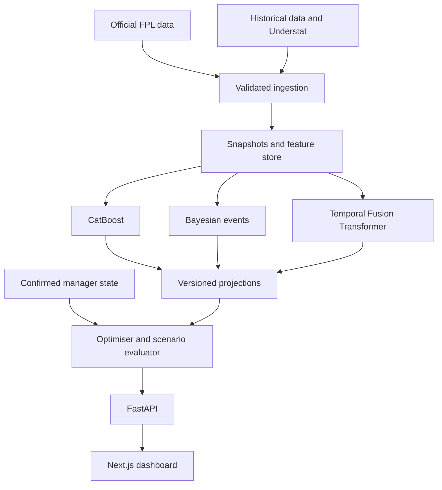

# Complete FPL build specification

Prepared for Sambhav on 9 October 2026. This is a build specification, not an implemented app.

This document combines all eight files from the build kit. For easiest use, extract the ZIP and follow README.md. Keep AGENTS.md in the project root and the remaining specifications in docs.


# File: README.md

# FPL build kit

Prepared for Sambhav on 9 October 2026.

This folder contains a specification and prompts for building a personal Fantasy Premier League assistant in Cursor and with Codex in the terminal. It contains planning documents, not a working application or trained models.

The starting assumptions are a personal application, free data, local development on macOS, and manually confirmed transfers on the official FPL website. These are reversible product defaults, not requirements to ask about before starting.

| File | Purpose |
|---|---|
| FPL_PRD.md | Product requirements, user flows, priorities, and release criteria |
| TECH_STACK_AND_ARCHITECTURE.md | Stack, repository layout, API contracts, jobs, and deployment approach |
| DATA_AND_MODEL_SPEC.md | Data collection, feature timing, three models, uncertainty, and validation |
| BUILD_PLAN_AND_TESTS.md | Ordered milestones, acceptance tests, and release checks |
| AGENTS.md | Repository instructions for coding agents |
| CURSOR_CODEX_PROMPTS.md | Initial prompt and prompts for each build stage |
| SOURCES.md | Research references, verification status, and unresolved assumptions |

## Use this kit

1. Create an empty project folder named `fpl-assistant` and open it in Cursor.
2. Copy `AGENTS.md` to the project root.
3. Copy the other Markdown files into a `docs` folder. Keep this README in `docs` too.
4. Paste the first prompt from `CURSOR_CODEX_PROMPTS.md` into Cursor Agent or the interactive Codex session.
5. Build one milestone at a time. Require its acceptance checks before starting the next milestone.
6. Keep `docs/BUILD_STATUS.md` updated with completed work, unresolved limitations, and the next task. The coding agent will create this file.

If Codex is already installed and authenticated, run `codex` from the project root and paste the same prompt. The installation reference is in SOURCES.md. Do not select a specific model or install an OpenAI API integration solely to build this application.

Use one coding session to modify a given checkout at a time. Cursor can handle the interface and Codex can handle backend or review work, but avoid simultaneous edits in the same files. Separate worktrees are optional once you are comfortable with Git.

## Scope at a glance

The first useful release imports a public squad, lets you correct current team information, creates transparent baseline projections, and recommends legal lineups and single transfers. The complete planned release adds CatBoost, a Bayesian event model, a Temporal Fusion Transformer, six Gameweek planning, and chip scenarios.

The baseline is an engineering checkpoint. It must be clearly labelled. An advanced model becomes the active forecast only after evaluation shows why it should be used.

The most valuable first task is storing dated data snapshots. Current injuries, prices, and fixture expectations cannot reliably be reconstructed from final season tables later.

Sources support factual platform and game claims. All architecture choices, thresholds, performance budgets, and proposed model designs in this kit are engineering recommendations, not externally established facts or promised accuracy.


# File: FPL_PRD.md

# FPL product requirements

Version: 1.0. Date: 9 October 2026. Working name: FPL Assistant.

## 1. Product outcome

Help Sambhav make better Fantasy Premier League decisions by combining player forecasts with the exact constraints of his squad. Recommend transfers, starting XI, captain, vice captain, bench order, and chip scenarios. Explain expected benefits, uncertainty, and the assumptions behind each recommendation.

The default objective is maximum expected FPL points over the next six Gameweeks after transfer penalties. A separate competitive mode may later target the probability of beating a particular mini league rival.

This product covers the standard FPL game. It does not cover FPL Draft, FPL Challenge, American football, or daily fantasy contests.

## 2. User and product defaults

1. One personal user in the first release.
2. Free data in the initial build.
3. Local application with persisted data.
4. Recommendations are advisory. The user makes changes on the official FPL website.
5. Team ID import with corrections for information unavailable publicly.
6. Six Gameweeks as the default horizon, adjustable from one to eight.
7. Current points maximisation as the default mode.
8. Desktop first, with a readable mobile layout.
9. No paid subscriptions, commercial deployment, or account integration required to deliver the first useful release.

## 3. Problems to solve

| Problem | Required outcome |
|---|---|
| A points ranking ignores my squad | Recommendations account for bank, selling prices, positions, and club limits |
| A transfer looks good for one week | Compare its effect across the planning horizon |
| A player may not start | Display appearance and minutes probabilities |
| I have already changed my squad | Let me correct the imported public squad before solving |
| The model suggests too many moves | Account for hits, saved transfers, and the value of flexibility |
| The recommendation is a mystery | Explain the relevant fixtures, minutes, and scoring components |
| A beautiful backtest may use future data | Show the information cutoff and record forecasts before deadlines |

## 4. Functional scope

### P0: first useful release

1. Fetch and archive official player, fixture, and event data.
2. Import a squad using a numeric team ID or a valid official Points page URL.
3. Show the import Gameweek and distinguish it from the upcoming Gameweek.
4. Correct players, bank, free transfers, selling prices, captaincy, bench, and chip availability.
5. Validate a 15 player squad and persist it locally.
6. Generate a labelled baseline forecast for the available fixtures.
7. Recommend starting XI, captain, vice captain, and bench order.
8. Compare keeping the team with feasible single transfers.
9. Show projected points before and after a hit, where applicable.
10. Save alternative plans without submitting anything to FPL.
11. Provide an offline demo and meaningful empty, error, loading, and stale states.

### P1: complete personal decision tool

1. Train and evaluate CatBoost, Bayesian, and TFT model families.
2. Publish comparable forecasts through one common projection contract.
3. Use validated ensemble weights when they improve performance.
4. Solve sequences of transfers across several Gameweeks.
5. Simulate automatic substitutions, vice captain fallback, and shared match outcomes.
6. Evaluate Wildcard, Free Hit, Bench Boost, and Triple Captain scenarios.
7. Allow player locks, exclusions, minutes overrides, and a maximum number of hits.
8. Show model disagreement and sensitivity to assumptions.
9. Maintain a log of forecasts, recommendations, outcomes, and evaluation runs.

### P2: optional extensions

1. Exact current squad sync through a verified session based method or browser extension.
2. Timestamped news extraction and reviewed availability updates.
3. Mini league tracking and explicit chasing or defending objectives.
4. Price movement scenarios using available official information.
5. Hosted access with authentication and backups.
6. Licensed event or expected lineup data if free data proves insufficient.

## 5. Explicit exclusions

The initial product does not place transfers, scrape commercial projections behind a paywall, require an LLM API key, promise a rank improvement, or claim three models are trained when they are placeholders. Live whole game rank reconstruction, detailed Opta heatmaps, payments, and a mobile app are outside the first release.

## 6. Main user flow

1. Open the app and see the next FPL deadline with a data timestamp.
2. Enter a team ID or load the demo.
3. Review the imported public squad and its source Gameweek.
4. Confirm current players, financial information, transfers already made, and chips.
5. Resolve any missing selling prices or unknown free transfers.
6. Run analysis for the selected horizon.
7. Compare Keep, Best single move, Best combination, and chip scenarios where supported.
8. Inspect projected benefit, downside, assumptions, and alternative plans.
9. Save a plan and receive a plain list of actions to perform manually in FPL.

Lineup analysis can run with unknown financial information. Transfer recommendations must remain blocked until bank, free transfers, and relevant selling prices are confirmed.

## 7. Screen requirements

| Route | Content |
|---|---|
| `/` | Imported squad, next deadline, readiness, suggested lineup, recommendation summary |
| `/players` | Searchable projections table, position and price filters, fixture details |
| `/planner` | Squad by Gameweek, transfer actions, bank, free transfers, captain, chips |
| `/models` | Active forecast, model availability, validation metrics, disagreement |
| `/history` | Saved plans, published forecasts, realised results |
| `/settings` | Team import, manager state corrections, refresh, overrides, export, delete local state |

Use a football pitch view for the lineup and an accessible table showing the same information. Position meaning must remain clear without relying on colour. Use keyboard accessible controls and visible loading indicators. Show money in millions but store integer tenths internally.

A player card should show name, club, FPL position, price, projected points, upcoming fixtures, minutes assumption, and availability warning. Do not imply decimal projections are precise outcomes.

## 8. Recommendation contract

Every recommendation must identify:

1. Current manager state and its version.
2. Data snapshot and forecast version.
3. Deadline and forecast horizon.
4. Players entering and leaving.
5. Bank and free transfers after the actions.
6. This week and horizon points relative to the Keep plan.
7. Gross improvement, total transfer penalty, and incremental penalty relative to Keep.
8. Formation, captain, vice captain, and bench order.
9. Chip and its effect, if any.
10. Major assumptions, data gaps, and model disagreement.
11. Scenario statistics when a calibrated simulator exists.
12. Solver status, time limit, and optimality gap where available.

Explain differences using stored calculations. If a transfer is mainly valuable because it enables another move, say so. If several plans are effectively tied relative to model uncertainty, present them as alternatives.

Do not manufacture a confidence percentage by mapping a score to a percentage. Before probabilistic calibration is available, display uncertainty as unavailable and show concrete sensitivity cases.

## 9. Season rules

Facts below are based on the official 2026/27 material cited in SOURCES.md. Verify the current live rules and configuration when implementing. Store the rule version and verification timestamp.

| Constraint | Rule |
|---|---|
| Initial budget | 1000 units, where one unit is £0.1m |
| Squad | 2 GK, 5 DEF, 5 MID, 3 FWD |
| Starting XI | 11; 1 GK; at least 3 DEF, 2 MID, 1 FWD |
| Club limit | At most 3 players from one club, subject to official handling of real club transfers |
| Captain | Starting player; double points; eligible vice captain fallback |
| Free transfers | One ordinary allowance per Gameweek, up to five stored |
| Extra transfers | Four points per transfer above the available allowance |
| Ordinary limit | Up to 20 transfers in one Gameweek; chip exceptions |
| Chips | Two sets of Wildcard, Free Hit, Bench Boost, Triple Captain |
| First chip window | Through the Gameweek 19 deadline in this season |
| Free Hit | Temporary squad; cannot be played in consecutive Gameweeks |
| Wildcard and Free Hit | Preserve saved transfers under the current rules |

An imported squad with more than three players at a club due to a real world transfer must be identified as a special state. Verify the official transfer restriction and require a compliant resulting squad before recommending moves. Do not silently remove a player.

### Fantasy scoring matrix

| Event | Points |
|---|---:|
| Appearance below 60 minutes | 1 |
| Appearance at least 60 minutes | 2 |
| Goal by GK / DEF / MID / FWD | 10 / 6 / 5 / 4 |
| FPL assist | 3 |
| Clean sheet by GK or DEF / MID | 4 / 1 |
| Every three goalkeeper saves | 1 |
| Penalty save | 5 |
| Penalty miss | Minus 2 |
| Every two conceded goals by GK or DEF | Minus 1 |
| Yellow / red card | Minus 1 / minus 3 |
| Own goal | Minus 2 |
| Match bonus | 1, 2, or 3, with official tie handling |
| Defensive contribution threshold | 2 per fixture, without stacking |

Defenders need 10 combined clearances, blocks, interceptions, and tackles. Midfielders and forwards need 12, including recoveries. Clean sheets require the applicable 60 minute eligibility and concession conditions. Verify assist and card edge cases against the full official rules rather than treating this matrix as an exhaustive scorer.

Defensive contribution points, revised bonus scoring, assist definitions, clean sheet eligibility, red card handling, and finalisation timing must be modelled or explicitly marked approximate. Automatic substitutions must preserve legal formation.

## 10. Correctness and reliability requirements

1. No illegal recommendation passes final validation.
2. No unknown bank or selling price is treated as zero or current market value.
3. No stale plan is silently recalculated against a different manager state.
4. No forecast uses an observation first available after its stated cutoff.
5. A public import is labelled as public deadline data.
6. Provider outages do not delete the last good snapshot.
7. Importing a different team does not mix its financial state with the previous team.
8. Pending jobs survive an API restart and can recover from a worker failure.
9. All model outputs show their availability: baseline, trained, evaluated, disabled, or unavailable.
10. Real observations and synthetic demo data are clearly separated.

## 11. Product success and release gates

Correctness is a release requirement. Better predictive performance is an empirical goal.

For the first release, a recorded demo and one real public import must complete the flow from import to saved valid recommendation. The demo must work without network access after setup. The user must be able to inspect and correct every input that affects affordability.

For the modelling release, require chronological held out evaluation and publication of errors by position, appearance status, and horizon. A new model must justify activation against baseline forecasts. The ensemble may give a model zero weight if it adds no value.

For the advanced planning release, require replay tests for prices, hits, free transfer rollover, chip boundaries, temporary Free Hit state, and automatic substitutions. Compare net outcomes against consistent baseline policies using the same starting state.

## 12. Outstanding product choices

Keep the defaults unless the user changes them. Later decisions include a paid data budget, public hosting, exact account sync, and a mini league target. None blocks the initial local build.


# File: TECH_STACK_AND_ARCHITECTURE.md

# Tech stack and architecture

These are recommended implementation choices. Framework capabilities and references are listed in SOURCES.md. Resolve compatible stable package versions at project creation and commit lockfiles. Do not assume every package's latest version is compatible with every other package.

## 1. Chosen stack

| Layer | Choice | Purpose |
|---|---|---|
| Runtime | Supported Node LTS; Python 3.12 initially | Separate interface and data modelling runtimes |
| Interface | Next.js App Router, React, TypeScript | Dashboard and planner |
| Styling | Tailwind CSS, accessible component primitives | Consistent UI |
| Server data in UI | TanStack Query | Poll jobs, cache API data, handle stale state |
| Charts | Recharts | Forecast comparisons and evaluation |
| HTTP API | FastAPI, Pydantic | Typed validation and OpenAPI |
| Python dependencies | uv | Lock dependencies and run commands |
| JavaScript dependencies | npm | Keep the first setup simple; commit package lock |
| Application storage | SQLite, SQLAlchemy 2, Alembic | Manager state, jobs, runs, plans, metadata |
| Analytical files | Parquet | Reproducible feature and training tables |
| Analytical queries | DuckDB, pandas | Historical joins and feature building |
| Source retrieval | HTTPX | Timeouts, retries, validation |
| Models | CatBoost, PyMC, PyTorch Forecasting | Three planned modelling families |
| Optimisation | HiGHS through highspy | Constrained planning |
| Python tests | pytest, Hypothesis | Rule and pipeline invariants |
| Python quality | Ruff, mypy | Static checks |
| Interface tests | Vitest, Testing Library, Playwright | Components and complete flows |

Use a supported Node LTS compatible with the chosen Next.js release; record it in `.nvmrc`. Python 3.12 is a compatibility default, not a claim that it is the latest Python release. Test native dependency installation on the actual macOS architecture.

Keep Bayesian and TFT dependencies in optional `bayes` and `deep` extras. The baseline and CatBoost path must work without downloading a deep learning environment. No OpenAI API, vector database, Kubernetes, Redis, or Celery is required initially.

## 2. Architecture



The baseline also implements the projection interface and remains available as a fallback. Forecasting, scoring, import, and optimisation modules must have independent tests.

## 3. Repository layout

Use the following logical paths. This table is a layout specification, not an assertion that files already exist.

| Path | Responsibility |
|---|---|
| `AGENTS.md` | Agent instructions |
| `docs/` | This kit, build status, decision log |
| `apps/web/` | Next.js application |
| `apps/web/src/app/` | Pages and route layout |
| `apps/web/src/components/` | Pitch, tables, corrections, plan cards |
| `apps/web/src/lib/api/` | Generated types and query hooks |
| `backend/pyproject.toml` | Base dependencies and optional modelling extras |
| `backend/src/fpl_app/api/` | FastAPI routes |
| `backend/src/fpl_app/domain/` | Rules, money, manager state, plan validation |
| `backend/src/fpl_app/providers/` | Source adapters and response schemas |
| `backend/src/fpl_app/storage/` | Database models and repositories |
| `backend/src/fpl_app/features/` | Historical feature construction |
| `backend/src/fpl_app/models/` | Baseline, CatBoost, Bayesian, TFT, ensemble |
| `backend/src/fpl_app/optimisation/` | Candidate generation and scoring |
| `backend/src/fpl_app/evaluation/` | Forecast metrics and policy replay |
| `backend/src/fpl_app/jobs/` | Worker, leases, recovery |
| `backend/src/fpl_app/cli.py` | Data and model command interface |
| `backend/tests/` | Unit, property, integration tests |
| `fixtures/demo/` | Small synthetic or appropriately sourced sample data |
| `data/raw/` | Immutable source bytes, ignored by Git |
| `data/processed/` | Parquet datasets, ignored by Git |
| `data/models/` | Local model artifacts, ignored by Git |
| `data/app.sqlite` | Application state, ignored by Git |

## 4. Runtime and network topology

During local development, Next.js listens on localhost port 3000, FastAPI on 127.0.0.1 port 8000, and one worker handles jobs. The web server proxies `/api/:path*` to the same backend path. Use one origin in the browser.

The browser never calls FPL directly. Provider requests originate from the Python server. Store source base URLs as fixed configuration, not values supplied by users. Parse a team URL to an integer ID and construct the provider URL from that ID. Do not fetch arbitrary user supplied URLs.

Bind the personal backend to loopback by default. A hosted version requires authentication, scoped manager state, and persistent storage. Local assumptions are not sufficient security for an internet accessible deployment.

## 5. Application persistence

| Table | Important fields |
|---|---|
| `source_snapshots` | ID, provider, resource, captured_at, available_at, checksum, local path, schema version, status |
| `players` | Canonical ID, season, FPL element ID, FPL code, team, position |
| `fixture_versions` | Fixture ID, snapshot ID, kickoff, event assignment, known_at |
| `manager_states` | Team ID, state version, next event, bank, transfer allowance, chip state, completeness, provenance |
| `manager_picks` | State ID, player, acquisition identity, purchase price, sell price, position, captain flags |
| `transfer_ledger` | Effective event, in/out players, price units, chip context, source, recorded_at |
| `model_runs` | Model family, artifact hash, feature version, training cutoff, seed, validation references |
| `projection_runs` | Model run, source cutoff, target events, rule version, data mode |
| `player_projections` | Run ID, player, fixture, expected points, minutes, appearance probabilities, optional intervals |
| `plans` | Input fingerprint, state version, projection run, settings, actions, score, validity |
| `jobs` | Type, payload, status, progress, attempts, lease, timestamps, result ID, error code |
| `evaluation_runs` | Dataset version, forecast IDs, metrics, policy settings, outcome cutoff |

Use explicit unknown values, represented as null plus a completeness reason. Missing bank, free transfers, or selling prices cannot be inferred as zero. Avoid using floating point numbers for money.

Enable SQLite foreign keys, WAL mode, and short write transactions. Serialize computation jobs. Avoid simultaneous analytical and application writes to the same database. Raw and Parquet artifacts are immutable and referenced by checksum.

## 6. Jobs

Long tasks return a job ID immediately. A separate Python worker claims jobs transactionally, writes a lease and heartbeat, and records results. Polling is enough; WebSockets are optional.

States: `queued`, `running`, `succeeded`, `failed`, `cancelled`.

The worker must support expired lease recovery, bounded retries, cooperative cancellation, and idempotent outputs. An API restart must not lose queued work. A duplicate request with the same input fingerprint can return an existing completed result or active job.

Heavy model training never runs during an ordinary lineup request or inside a fragile HTTP background task. Start with one worker and persistent SQLite jobs. Add external queue infrastructure only if actual hosting needs it.

## 7. API contract

All routes use `/api/v1`. Error responses have `code`, `message`, `details`, and `request_id`. Use explicit statuses and machine readable codes.

| Method and route | Request | Response |
|---|---|---|
| `GET /health` | None | API and database status |
| `GET /status` | None | Provider freshness, current season, next event, model availability |
| `POST /data/refresh` | Resources and optional force flag | Job ID |
| `GET /players` | Event, position, price, search, projection run | Paginated player records |
| `GET /fixtures` | Event range | Known fixture versions |
| `POST /teams/import` | Team ID or validated official URL | Imported state and completeness report |
| `GET /teams/{team_id}/state` | None | Current persisted state |
| `PATCH /teams/{team_id}/state` | Expected version and corrections | Validated new version |
| `POST /projections/runs` | Cutoff, horizon, model family | Job ID |
| `GET /projections/runs/{run_id}` | None | Version and projection data |
| `POST /recommendations` | State version, projection run, settings | Job ID |
| `GET /jobs/{job_id}` | None | Progress or result reference |
| `POST /jobs/{job_id}/cancel` | None | Cancellation status |
| `POST /plans` | Recommendation ID or validated custom actions | Saved plan ID |
| `GET /plans/{plan_id}` | None | Plan and stale reasons |
| `GET /models` | None | Registry and validation status |
| `GET /evaluations` | Filters | Recorded forecast and policy metrics |

The `/health` entry in the table is relative to `/api/v1`, just like every other listed route.

### Manager state example

The following is a contract fragment; a valid complete payload contains all 15 picks and the full chip state.

```json
{
  "team_id": 123456,
  "state_version": 4,
  "season": "2026/27",
  "next_event": 7,
  "public_source_event": 6,
  "data_mode": "live",
  "bank_units": 12,
  "bank_provenance": "user_confirmed",
  "free_transfers_at_event_start": 2,
  "transfers_made_this_event": 1,
  "confirmed_hit_points": 0,
  "current_chip": null,
  "picks": [
    {
      "player_id": "canonical_example_player",
      "fpl_element_id": 101,
      "purchase_price_units": 75,
      "selling_price_units": 76,
      "selling_price_provenance": "user_confirmed",
      "position": 1,
      "is_captain": false,
      "is_vice_captain": false
    }
  ],
  "readiness": {
    "lineup_ready": true,
    "transfers_ready": false,
    "missing_fields": ["selling prices for remaining players"]
  }
}
```

Use `confirmed_hit_points` for points already committed this event. Keep points and price units as distinct domain types.

### Recommendation request

```json
{
  "team_id": 123456,
  "expected_state_version": 4,
  "projection_run_id": "projection_example",
  "settings": {
    "horizon_events": 6,
    "objective": "expected_points",
    "max_additional_hit_points": 4,
    "locked_player_ids": [],
    "excluded_player_ids": [],
    "chip_policy": "none",
    "solver_time_limit_seconds": 30
  }
}
```

### Recommendation result fields

Use `baseline_plan`, `alternatives`, `source_cutoff`, `rules_version`, `state_version`, and `projection_run_id` at the top level. Every alternative includes weekly actions, bank and transfer state, gross points, total hits, incremental hits, net points, delta to baseline, explanatory components, scenario metrics if available, and solver metadata.

Display `p10_points`, `p50_points`, and `p90_points` only if an appropriate distribution exists. Quantiles are distribution percentiles, not three independent predictions or a universal confidence interval.

### Errors and concurrency

Use `404` for unknown entries, `409 STATE_VERSION_CONFLICT` for an outdated edit, `409 STALE_INPUTS` for a changed fixture or state, `422 INCOMPLETE_MANAGER_STATE` for missing financial information, and `503 PROVIDER_UNAVAILABLE` when no acceptable source exists. A failed refresh with an old snapshot can return usable data and an explicit stale warning.

Generate TypeScript types from the backend OpenAPI contract. Never maintain a second, subtly different hand written schema in the frontend.

## 8. Local commands the agent must implement

These commands are target interfaces to create, not already working commands.

| Command | Responsibility |
|---|---|
| `npm run dev` in `apps/web` | Start the interface |
| `uv run uvicorn fpl_app.api.main:app --reload` in `backend` | Start FastAPI |
| `uv run python -m fpl_app.jobs.worker` in `backend` | Start one worker |
| `uv run python -m fpl_app.cli ingest --source fpl` | Fetch and archive source data |
| `uv run python -m fpl_app.cli demo` | Load an isolated demo |
| `uv run python -m fpl_app.cli features --cutoff ISO_TIMESTAMP` | Build a dated dataset |
| `uv run python -m fpl_app.cli train --model catboost` | Train against a recorded dataset configuration |
| `uv run python -m fpl_app.cli evaluate --run RUN_ID` | Evaluate frozen forecasts |
| `uv run pytest` | Backend tests |
| `uv run ruff check .` and `uv run mypy src` | Backend quality |
| `npm run lint`, `npm run typecheck`, `npm run test` | Interface quality |
| `npm run test:e2e` | Complete flow tests |

Add a root script to launch the three local processes and shut them down cleanly. Avoid requiring Docker for local work. Pin versions and document any platform specific installation exception.

## 9. Configuration

Create `.env.example` with nonsecret example values for `APP_ENV`, `DATA_DIR`, `DATABASE_URL`, `BACKEND_URL`, `FPL_BASE_URL`, `DEFAULT_HORIZON`, `PROVIDER_TIMEOUT_SECONDS`, and `PROVIDER_MIN_INTERVAL_SECONDS`.

The backend base URL used by Next.js is server configuration. Never expose cookies or secret provider credentials through public environment variables, Git, logs, exported plans, or a browser bundle. No credential is required for the default public data mode.

## 10. Proposed performance budgets

On the user's machine, measure rather than promise: cached dashboard below two seconds, import usually below fifteen seconds when providers respond, and first optimisation within a configurable thirty second time limit. Return the best valid incumbent when a time limit is reached. These are initial engineering targets.

Cache once per resource and serve multiple analyses from that snapshot. Record provider timestamps and model runtime. Use conservative request pacing, bounded exponential backoff for retryable failures, and respect `Retry-After`. Never bypass a provider block.

## 11. Deployment path

Deliver local use first. Later, containerise the web, API, and worker with persistent volumes and backups. SQLite remains suitable for a personal serialized worker; move to PostgreSQL when concurrency or multiple users warrants it.

Treat hosting and training separately. Short lived web functions are not the default place to train PyMC or TFT models. Do not assume a frontend deployment automatically provides durable backend storage or jobs.

## 12. Reproducibility

Record source checksums, rule version, feature version, dataset cutoff, training seed, package lock hashes, artifact hash, and Git revision. Plans retain the forecast version that created them. A later refresh marks a plan stale rather than silently rewriting its history.


# File: DATA_AND_MODEL_SPEC.md

# Data and model specification

This is the implementation contract for observations, features, forecasts, and decisions. The three advanced model families are CatBoost, Bayesian events, and Temporal Fusion Transformer. A transparent baseline is required for development and comparison.

## 1. Source strategy

| Source | Priority | Access and intended use |
|---|---|---|
| Official FPL JSON endpoints | Required | Current player universe, fixtures, events, player histories, public squads |
| Vaastav historical FPL archive | Required historical audit | Past player observations; no assumption of weekly current updates |
| Understat | Optional initial enrichment | Player and team attacking metrics and shot information |
| FPL Core Insights | Supplementary | Recent history, defensive actions, fixture context; audit field provenance |
| Football Data | Optional benchmark | Results and odds with a verified availability cutoff |
| Official club news | Later | Concrete availability information with timestamped source evidence |
| Licensed provider | Later | Structured expected lineups, injury history, detailed match events |

References and timing warnings are in SOURCES.md. Do not depend on FBref advanced tables as a current feed. Do not assume StatsBomb open data is a full current EPL dataset.

Use adapters that validate responses and preserve original bytes. Parse fields explicitly; tolerate new unrelated fields but reject missing required fields. Check that an API response is JSON with the expected structure rather than an HTML error document.

## 2. Official endpoints

Base URL: `https://fantasy.premierleague.com/api/`.

| Resource | Path |
|---|---|
| Bootstrap | `bootstrap-static/` |
| Fixtures | `fixtures/` |
| Player history | `element-summary/{element_id}/` |
| Public manager | `entry/{entry_id}/` |
| Manager history | `entry/{entry_id}/history/` |
| Public picks | `entry/{entry_id}/event/{event_id}/picks/` |
| Public transfers | `entry/{entry_id}/transfers/` |
| Live scores | `event/{event_id}/live/` |
| Private current team | `my-team/{entry_id}/`, deferred until current access is verified |

These are website endpoints with community documentation. During implementation, probe the required public endpoints without authentication, store schema fixtures, and document any changed shape. Never assume old authentication examples still work.

Initial refresh defaults: bootstrap and fixtures every six hours while the collector is running, manual refresh before solving, and additional capture shortly before deadlines. These are proposed schedules, not provider service guarantees. Implement configuration and graceful throttling. Capture exact timestamps rather than pretending every scheduled attempt ran on time.

Player histories can be cached after ingestion and refreshed after finalised matches. A failure preserves the last good snapshot. Avoid repeatedly requesting every player summary for each dashboard visit.

## 3. Immutable snapshot envelope

Required fields: `snapshot_id`, `provider`, `resource`, `captured_at`, `source_published_at` when supplied, `available_at`, `payload_sha256`, `schema_version`, `season`, `storage_path`, and `validation_status`.

Use UTC timestamps internally. The UI displays local time with a timezone label; deadline logic remains UTC. Unknown original publication time is null. For a newly captured live response, `available_at` is at least the capture time; never invent an earlier availability date.

Historical match dates establish when football happened, not necessarily when every revised statistic became available. Mark sources with uncertain information timing as unsuitable for strict replay of those fields. A conservative audit may still permit lagged completed match statistics while excluding historical injury flags, roles, odds, or price snapshots of unclear timing.

Archive fixture versions too. A final season fixture list does not establish which doubles or blanks were known earlier.

## 4. Identifiers and money

Maintain a canonical person ID and a mapping keyed by provider, provider player ID, and season. FPL element IDs can change between seasons. FPL `code` is a useful matching clue, not permission to skip mapping validation. Use names, club history, and available stable metadata to review unresolved matches; do not join solely on a display name.

Team identity also needs a season mapping. A player can change club or FPL position. Keep the historically applicable club and position on each observation.

Store all FPL money as integer tenths of a million. For an owned player:

```python
if current_price_units <= purchase_price_units:
    selling_price_units = current_price_units
else:
    selling_price_units = purchase_price_units + (current_price_units - purchase_price_units) // 2
```

Prefer a current verified private selling price or user confirmed selling price when purchase history is incomplete. Record which market snapshot the confirmed price belongs to. After a later market price change, recompute from known acquisition price or mark the confirmed selling price for review. Do not silently reuse a stale confirmation.

The sell and rebuy case creates a new acquisition record. Wildcard purchases use their actual acquisition price. Free Hit acquisitions do not replace the original persistent acquisition records.

## 5. Manager state reconciliation

An import creates a new version of a manager state. Public picks identify a deadline squad, not an exact current private team. Public history can support reconstruction, but cannot reveal every change made since the most recent deadline.

Each financial field has provenance: `private_verified`, `public_reconstructed`, `user_confirmed`, or `unknown`. Add a confirmation timestamp and supporting source. A reconstructed value remains distinguishable from a confirmed current value.

Track `free_transfers_at_event_start`, `transfers_made_this_event`, `confirmed_hit_points`, `current_chip`, `persistent_squad`, and `active_squad`. Keep a start of event state and a transfer ledger. If the start state cannot be established, require the missing information before offering a chip that depends on it.

A public picks response may contain final multipliers and automatic substitution information. Use documented lineup positions and captain flags appropriately, and do not mistake a final scoring multiplier for the manager's original starting selection. Verify the payload on a week with an automatic substitution.

For an ordinary event, with `f` free transfers at event start and `t` total transfers in that event:

```python
total_hit_points = 4 * max(0, t - f)
next_event_free_transfers = min(5, max(0, f - t) + 1)
```

Proposed moves add to already made moves. Compute the incremental cost relative to Keep so committed hits are not charged a second time in the recommendation delta. If current chip rules cancel hits or preserve transfer inventory, route through a separate chip transition function. Under the cited current rule, Wildcard or Free Hit preserves the saved transfer count rather than applying the ordinary transition; verify this against live game state before activating chip solving.

Free Hit requires the correct persistent squad from before the event's temporary moves. On the following event, restore its acquisition records and apply current market prices; do not restore outdated market prices. The precise bank and transfer transition must match verified official behaviour.

## 6. Canonical observation table

Primary key: season, canonical player, fixture ID. A Gameweek may have zero, one, or more fixtures for a player.

Store league, event assignment version, kickoff, club, opponent, venue, position, minutes, start flag where known, goals, FPL assists, clean sheet result, conceded goals, saves, penalties, cards, own goals, bonus, BPS, defensive actions, xG, xA, and final FPL points.

Use official FPL results as the final fantasy scoring target. External assists and defensive action definitions can differ. Retain provider labels and map definitions deliberately.

Represent eligible players who do not appear as zero minute outcomes when source coverage permits. Distinguish no appearance, no scheduled fixture, missing record, and missing statistic. Missing defensive actions are not zero actions.

Deduplicate player fixture rows, especially in Double Gameweeks. Avoid cumulative season statistics being treated as per match values. If differencing cumulative records, handle data revisions and transfers and validate against fixture level records.

## 7. Feature timing and feature groups

Every forecast has a `decision_cutoff`. Features must be built only from information available at or before it. For all fixtures in a Gameweek, use the FPL deadline cutoff, not each individual kickoff.

Recommended features:

| Group | Features |
|---|---|
| Opportunity | Starts, minutes, substitutions, absence frequency, recent return from injury |
| Attacking rates | xG and xA per 90, shots, key passes, longer term rate priors |
| Team strength | Recency weighted goals and xG for and against, venue effects |
| Defensive involvement | Position appropriate action distributions and threshold frequency |
| Goalkeeping | Save rates, expected concession environment, historical bonus patterns |
| Context | Rest days, European and cup minutes, fixture congestion, role changes |
| Future schedule | Known opponents, venue, event assignment, blank and double scenarios |
| Availability | Timestamped status and concrete news; null remains unknown |
| Roles | Penalty and set piece rank, with historical timing verified |

Use candidate windows of 3, 5, 10, and 20 matches, plus recency weighting. Select windows on training and validation data. Rate features must handle small exposures with shrinkage or longer term priors; a substitute's one shot should not establish an elite true rate.

Exclude the potentially updated historical `xP` field initially. Exclude same fixture realised minutes, xG, BPS, points, and closing odds unavailable at the FPL deadline from input features. Standardisation, imputation, feature selection, and encoding are fitted on training partitions only.

For future horizons, never insert future realised injury, minutes, or match outcomes. During a six week forecast, subsequent weeks use assumptions or simulated future state. Weekly replay may update the policy when that future week actually arrives.

## 8. Common forecast contract

Every model emits the same logical fields:

```json
{
  "projection_run_id": "example_run",
  "model_family": "baseline",
  "model_status": "evaluated",
  "player_id": "example_player",
  "fixture_id": 501,
  "event": 7,
  "decision_cutoff": "2026-10-01T12:00:00Z",
  "expected_points": 4.3,
  "expected_minutes": 72.0,
  "appearance_probability": 0.93,
  "start_probability": 0.84,
  "minutes_60_probability": 0.78,
  "point_quantiles": null,
  "components": null,
  "assumptions": ["illustrative payload, not a real forecast"]
}
```

Expected points are unconditional on appearance. If a component model predicts conditional returns, combine availability once. Never multiply an already unconditional prediction by appearance probability again. Quantiles and component breakdowns are optional and must be unavailable rather than fabricated.

FPL points can be negative. Do not clip all forecasts, samples, or intervals to zero. Poisson or negative binomial distributions are suitable for event counts, not a total FPL score with negative outcomes.

Fixture forecasts aggregate to Gameweek forecasts. Means sum, but quantiles and variances require joint samples or an explicit dependence assumption. Do not sum player percentiles to create a squad percentile.

## 9. Baseline

Implement an explainable component baseline with recent minutes distributions, shrunk attacking rates, venue and team adjustment, clean sheet probabilities, and a labelled approximate bonus contribution. If defensive data is absent, mark the defensive component unavailable or use an explicitly documented prior.

Also keep a simple recent points average baseline for evaluation. These are references for model quality, not the planned advanced product.

## 10. Model 1: CatBoost

Use structured features to predict unconditional expected fixture points. Begin with an RMSE mean objective; evaluate position specific models or position aware pooled models. Train auxiliary appearance, start, and minutes threshold predictions when labels are available. Keep auxiliary outputs coherent and calibrate probabilities.

Quantile heads can later estimate point percentiles. A quantile model targets a percentile, not the mean used by a points maximiser. Address quantile crossing and assess coverage. Do not apply Poisson directly to potentially negative total points.

Use chronological tuning, early stopping on a later validation block, regularisation, and reproducible seeds. Compare performance for starters, low minutes players, new players, and high expected return candidates. Store feature importance; describe it as model attribution rather than causal proof.

## 11. Model 2: Bayesian events

Build a hierarchical model of team attack and defence, with venue and time effects. Model player contribution and exposure, sharing information by position or role. Test Poisson and overdispersed event count assumptions. Use an identifiable parameterisation and check posterior convergence.

Generate coherent match scenarios: shared team goals, player scoring and assist allocation, minutes, saves, defensive thresholds, cards, and bonus. Account for changing roles and small samples through priors.

Exact BPS reconstruction requires many event inputs. When they are unavailable, use a validated approximate bonus model and label the component. Do not claim full Opta scoring replication from summary statistics.

Check posterior predictive fit and convergence diagnostics. Start with small datasets for installation and execution checks, then use the real audited training panel. Preserve posterior or predictive samples and seeds. Avoid presenting posterior parameter uncertainty as the full range of possible match outcomes.

## 12. Model 3: Temporal Fusion Transformer

Use a compact global model across player sequences. Include historical observations, known future fixture information, and static role information. Unknown future minutes, injury, xG, and points cannot be supplied as future inputs.

Use a padded and masked event representation or an equivalent fixture sequence representation that preserves multiple fixtures and zero fixture events. Define sequence indexing explicitly and test Double Gameweeks. A single averaged opponent for a double is insufficient.

Start with limited depth and embedding size, regularisation, and early stopping. Separate a mean target used for expected points from quantile targets; a median is not automatically an expected score. Keep CPU execution feasible for inference and document any accelerator needed for training.

Activation requires chronological held out performance. Architecture suitability is a hypothesis. Do not ship a placeholder neural model with synthetic outputs labelled trained.

## 13. Ensemble and scenario evaluation

Learn nonnegative weights summing to one from forecasts produced on validation folds, without training contamination. Use one global blend first; add position or horizon specific weights only with enough evidence. Weight zero is valid.

Compare the blend against its best individual model. Do not learn weights on the final test period. Track model disagreement as one indication of uncertainty, not a calibrated confidence score.

A mixture of predictive distributions has quantiles different from averaged quantiles. Preserve joint football relationships when combining forecasts with a scenario engine. If only independent marginal estimates exist, explicitly state that squad risk metrics are approximate and avoid strong rank claims.

## 14. Decision engine

Use HiGHS to generate feasible plans under budget, position, club, transfer, chip, and state transition constraints. Default horizon six events. Include Keep and transfer saving. Score net points and maintain terminal value for bank, squad quality, and saved transfers so the final planning week does not create an artificial spending spree. Fit or sensitivity test those terminal values.

Persist market and purchase prices separately. Candidate squad ownership evolves with transfers. Support player locks and exclusions. Handle solver limits and report the best valid incumbent plus gap when available.

Evaluate leading candidates with shared match scenarios, captain fallback, formation preserving bench substitutions, and chip effects. Approximate linear bench weights can generate candidates, but must be labelled and reranked using the fuller evaluator when available.

A mathematical optimum is conditional on forecasts, assumptions, candidate universe, horizon, and solver formulation. It is not a guarantee of maximum realised points.

## 15. Evaluation protocol

Use expanding chronological folds across complete Gameweeks. Purge training targets that cross a validation cutoff for overlapping future horizons. Choose hyperparameters and ensemble weights on validation folds, then evaluate once on the held out period.

Evaluate mean forecast MAE and RMSE, ranking quality among plausible picks, probability calibration for appearances and thresholds, quantile pinball loss and interval coverage, and full policy points after hits. Bootstrap or otherwise assess differences with Gameweek blocks; player rows from one match are not independent experiments.

A full policy replay needs historical bank, acquisition prices, free transfers, chips, and candidate availability. If those are incomplete, label the result as lineup evaluation or partial transfer replay instead of a complete season backtest.

Publish separate results by position, horizon, minutes category, new versus established players, and ordinary versus double or blank events. Compare every policy from the same initial state and the same information access.

## 16. Model registry and fallbacks

States: `not_installed`, `not_trained`, `trained`, `evaluated`, `active`, `disabled`.

If a model is unavailable, omit it and show the reason. If enrichment fails, fall back only to a model trained for that reduced feature set. Do not substitute zeros into a rich model and hope its outputs remain calibrated.

Before a deadline, freeze the source and prediction versions used for the recommendation. Evaluate outcomes only after the event is finalised. Compare real and demo runs separately.


# File: BUILD_PLAN_AND_TESTS.md

# Build plan and acceptance tests

Build sequentially. Keep `docs/BUILD_STATUS.md` current. Every milestone records changed files, commands actually run, results, remaining limitations, and the next task. Do not report a command as passed if it was only suggested.

## Milestone 0: scaffold and reproducible demo

Create the web app, Python package, database migrations, configuration examples, job skeleton, and test tooling. Generate the frontend API types from OpenAPI. Resolve stable compatible versions and commit lockfiles.

Create a deterministic demo with enough players across clubs and positions to form several legal squads. Label it synthetic. Keep synthetic data physically and logically separate from live data. Use no network calls in the demo tests.

Acceptance: web and API start; health check passes; migration runs on an empty database; demo dashboard renders; root startup and shutdown instructions work; baseline tests and static checks pass.

## Milestone 1: rules and manager state

Implement integer money, legal squad checks, starting formations, selling prices, acquisition tracking, transfer transitions, and corrections with optimistic version checks. Implement current season rule configuration with verification metadata.

Acceptance: all money, squad, formation, and ordinary transfer tests below pass. Missing financial fields block transfer solving but permit valid lineup analysis. Demo state persists across restart.

## Milestone 2: source collection and public team import

Implement official FPL bootstrap, fixtures, player history, manager, picks, and history adapters. Fetch selected player histories without overwhelming the provider. Archive source payloads and fixture versions. Add URL parsing, readiness reports, correction UI, stale state handling, and manual refresh.

Acceptance: import one real public team; show source Gameweek; correct a recent transfer and financial state; survive an API failure using the last good snapshot; prevent arbitrary URL fetching; confirm that demo and live states never mix.

## Milestone 3: baseline projections and current week decisions

Build a dated feature pipeline, transparent baseline, projection store, lineup optimisation, captain and vice selection, bench ordering, and feasible single transfer comparison. Keep the six event display available where fixtures exist, but label the initial solver as limited to current week decisions.

Acceptance: Keep appears in every comparison; recommended actions are affordable and legal; displayed differences reconcile with calculations; projection provenance is visible; stale state is rejected; a saved recommendation reloads with the same forecast version.

This is the first useful personal release. Do not postpone it while waiting for three complex models.

## Milestone 4: historical audit and CatBoost

Audit source coverage, IDs, same fixture data leakage, potentially revised xP, zero minutes records, and feature availability. Implement chronological folds and baseline metrics. Train CatBoost and supporting availability models on real audited data.

Acceptance: no feature is available after its cutoff; a training run produces a reproducible artifact; held out metrics are recorded; activation is justified against the baseline; interface distinguishes trained, evaluated, and active status.

## Milestone 5: horizon planning

Extend the optimiser to a six event horizon with bank, purchase prices, transfer inventory, hits, and terminal value. Allow locks, exclusions, horizon changes, and a maximum additional hit budget. Show alternative transfer sequences.

Acceptance: saved transfer rollover, sell and rebuy, multiple moves, and already committed hits are correct; no artificial final week spending occurs in a controlled test; solver timeout returns a validated incumbent or an explicit no result.

## Milestone 6: Bayesian model and fuller simulation

Build the Bayesian event model, calibrated minutes states, shared match scenarios, automatic substitutions, and vice captain fallback. Add posterior diagnostics and partial component warnings.

Acceptance: scenario frequencies match expected probabilities within simulation error; players from one team share match conditions; bench legality holds in every sampled scenario; approximate bonus components are identified; uncertainty metrics are calibrated or unavailable.

## Milestone 7: TFT and ensemble

Implement the compact TFT pipeline, future covariate rules, masking, double fixtures, evaluation, and validated ensemble weights. Keep the deep dependency optional.

Acceptance: TFT trains on a small real panel; no future observed covariate leaks; means and quantiles retain their correct meaning; held out comparison is recorded; the ensemble can exclude a weak or missing model; inference works with reproducible artifacts.

## Milestone 8: chips and complete personal release

Implement chip windows, inventory, transition rules, and scenario evaluation. A chip requiring unavailable start of event state must be disabled with a useful explanation. Finish saved plans, history, exports, accessibility, backups, and recovery.

Acceptance: current official chip behaviour is verified; all chip tests pass; one complete demo and one real imported state reach a saved plan; the app gives a clear manual action list and submits no FPL changes.

## 1. Money tests

| Case | Expected result |
|---|---|
| Buy 75, market 78 | Sell 76 |
| Buy 75, market 76 | Sell 75 |
| Buy 75, market 79 | Sell 77 |
| Buy 75, market 74 | Sell 74 |
| Bank 5, sell 76, buy 81 | Bank 0 |
| Bank 5, sell 76, buy 82 | Reject as unaffordable |
| Sell and later rebuy | New acquisition price is used |
| Unknown acquisition and no confirmed sell price | Transfer solving blocked |
| Confirmed sell price from an old market snapshot | Recompute or require confirmation |

## 2. Squad and lineup tests

1. Exactly 15 unique eligible players and required positional counts.
2. Three players from a club allowed; four rejected for an ordinary resulting squad.
3. One goalkeeper, 3 DEF, 5 MID, 2 FWD is a legal XI.
4. One goalkeeper, 5 DEF, 4 MID, 1 FWD is a legal XI.
5. Two defenders or no forward is illegal.
6. Captain and vice are distinct starting players.
7. The goalkeeper substitute does not occupy an outfield bench slot.
8. A real world club transfer exception is explicitly reconciled.

## 3. Scoring tests

Use the verified season rule configuration. Test 0, 1, 59, 60, and 90 minutes; position dependent goal points; saves at 2, 3, 5, and 6; clean sheet eligibility; conceded goals at 1, 2, 3, and 4; penalty misses and saves; own goals; card combinations; and bonus ties.

For defensive contribution, a defender at 9 actions earns zero and at 10 earns two; at 20 earns two, not four. A midfielder or forward at 11 relevant actions earns zero and at 12 earns two. Recoveries contribute only under the correct position rule.

Check a player substituted after 60 minutes before a later concession, a player leaving before 60, and red card concession handling. Test the official rule for cards received without an appearance when evaluating automatic substitution eligibility; do not infer this rule from minutes alone.

Total points may be negative. Make sure scoring and forecast display can represent them.

## 4. Transfer tests

| Ordinary event start | Total moves | Total hit | Next event allowance |
|---|---:|---:|---:|
| 1 free transfer | 0 | 0 | 2 |
| 1 free transfer | 1 | 0 | 1 |
| 1 free transfer | 2 | 4 | 1 |
| 2 free transfers | 1 | 0 | 2 |
| 2 free transfers | 3 | 4 | 1 |
| 5 free transfers | 0 | 0 | 5 |
| 5 free transfers | 4 | 0 | 2 |

Test one move already made with an event start allowance of two: one further move has no hit and two further moves create a four point total hit. In a recommendation delta, already committed penalties appear in both comparable plans rather than being counted twice.

If a Wildcard is activated after ordinary transfers, verify that the appropriate penalties are cancelled. Track total event moves, not just the difference between the final and starting squads; a sell and rebuy may involve moves despite identical final ownership.

## 5. Chip tests

1. Chip availability matches the verified season windows.
2. Unused first window chips expire at the correct deadline.
3. One chip per event.
4. Consecutive Free Hits rejected, including across the window boundary.
5. Free Hit temporarily changes active ownership and restores persistent ownership next event.
6. Original acquisition records survive Free Hit.
7. Wildcard permanently changes ownership and acquisition records.
8. Saved free transfers follow the verified chip rule.
9. Bench Boost scores eligible bench players without duplicate counting through substitution logic.
10. Triple Captain applies the correct multiplier and eligible fallback.
11. A chip plan cannot run with unknown required inventory or restore state.

## 6. Automatic substitution tests

1. Missing goalkeeper uses only the reserve goalkeeper if eligible.
2. In a XI with three defenders, a missing defender cannot be replaced by a midfielder while leaving only two defenders.
3. If the first bench player would violate formation, a later legal player may enter.
4. Multiple missing players produce a legal XI with the official priority order.
5. A one minute cameo prevents the ordinary no appearance substitution.
6. A captain missing both fixtures of a double allows eligible vice fallback; appearing in either fixture prevents that fallback.
7. Neither captain nor vice eligible means no captain multiplier.
8. Same club competing goalkeepers have linked appearances in the scenario model.

## 7. Data and leakage tests

1. Every feature record has a decision cutoff and source reference.
2. A future dated source cannot enter an earlier feature join.
3. Same fixture minutes and points cannot be features for its forecast.
4. A double's second fixture cannot use the first fixture's outcome at the original deadline.
5. End of season roles and injury flags are excluded from earlier decisions.
6. Historic xP is excluded by default.
7. Fixture reassignment uses the version known at the deadline.
8. Overlapping future targets do not cross validation partitions.
9. Scalers and imputers are fitted on training data only.
10. Missing statistics are distinguishable from genuine zeros.
11. No duplicate player fixture rows.
12. A new provider schema fails clearly and preserves the prior good data.

## 8. Job, state, and interface tests

Test duplicate requests, worker crash and expired lease recovery, cancellation, conflicting state edits, source outage, partial import, invalid team URL, stale projection, absent optional model, and reload after saving.

Use a small offline integration dataset to verify the full path: import response, correction, feature build, projection, recommendation, validation, persistence, and reload. Add a separate optional live provider check; normal CI should not depend on FPL uptime.

The interface must show the source Gameweek, unknown finances, data timestamps, active model, approximation labels, and errors. Cover keyboard use, table accessibility, mobile width, and long player names. Never show demo data as the user's imported squad.

## 9. Evaluation and activation

Record MAE, RMSE, ranking quality, appearance calibration, threshold calibration, and interval coverage where relevant. Measure recommendations using realised net points, captaincy, hit usage, and legal state transitions. Use consistent starting states and Gameweek blocked uncertainty estimates.

Promote a model only after it improves a defined validation objective without unexplained calibration failures. Compare once on the untouched test period. If no advanced model beats the baseline, report that honestly and keep the baseline active while investigating.

## 10. Definition of done

1. Relevant domain tests and integration flow pass.
2. Static checks and interface build pass.
3. Every reported test was actually run.
4. Database migrations and restart persistence work.
5. No secrets or personal state in Git.
6. Data and model limitations are visible.
7. Documentation matches the commands and schemas actually implemented.
8. The milestone has a short reviewable change summary and an updated build status.

The complete product additionally requires the three genuine model implementations, their evaluation records, the advanced planning engine, and verified chip handling. Completing the baseline milestone alone is not completing the whole project.


# File: AGENTS.md

# FPL Assistant agent instructions

Read this file before editing the project. Read the relevant specifications in `docs` before implementing a milestone.

## Product

Build a personal standard Fantasy Premier League decision tool. Default to free data, local development, and manual execution of transfers by the user. The complete product includes CatBoost, Bayesian events, TFT, and a separate rules aware optimiser. A labelled baseline is the first usable milestone.

## Specification order

1. Explicit user instructions.
2. Current verified official FPL rules.
3. `docs/FPL_PRD.md` for product scope.
4. `docs/DATA_AND_MODEL_SPEC.md` for data, manager state, and models.
5. `docs/TECH_STACK_AND_ARCHITECTURE.md` for interfaces and structure.
6. `docs/BUILD_PLAN_AND_TESTS.md` for delivery order and checks.

If documents conflict, resolve the smallest reversible choice and record it in `docs/DECISIONS.md`. A material unresolved rules conflict must disable the affected recommendation rather than invent behaviour.

## Implementation

Use Next.js, React, TypeScript, and a Python FastAPI backend. Use SQLite for app state, Parquet for analytical artifacts, uv for Python dependencies, and npm for the interface. Make Bayesian and TFT dependencies optional.

Build the requested milestone completely before moving on. Do not create a dashboard full of invented advanced model outputs. Keep `docs/BUILD_STATUS.md` current and inspect it when resuming.

## Domain correctness

1. Store money as integer tenths of a million. Keep points a separate type.
2. Distinguish market, purchase, and selling prices.
3. Track already made transfers and committed hits, not only proposed moves.
4. Distinguish persistent and temporary Free Hit squads.
5. Treat unknown financial or chip state as unknown.
6. Public team ID import represents a deadline squad and may miss recent changes.
7. Validate every recommendation independently after solving.
8. Save transfer inventory and chip windows as explicit season rules.
9. Preserve formation, bench priority, and captain fallback rules.
10. Keep unavailable and approximate features visible to the user.

## Data and forecasting

1. Save immutable source bytes and timestamps.
2. Build features as of the FPL deadline, including both fixtures of a double.
3. Exclude same fixture outcomes and unverified historical xP.
4. Fit preprocessing and ensemble weights on training or validation partitions only.
5. Distinguish absent players, blank events, missing rows, and missing statistics.
6. Keep cross season player mappings explicit.
7. Means, medians, quantiles, and confidence statements have different meanings.
8. Expected points are unconditional on appearance; never apply availability twice.
9. Use genuine training and evaluation artifacts before calling a model trained.
10. Never guarantee rank or assume a complex model beats a baseline.

## Application integrity

Fetch provider data through the backend. Construct provider URLs from validated IDs. Do not request arbitrary pasted URLs. Keep source credentials and private manager data out of Git and logs. Use version checks for edits and input fingerprints for jobs and plans.

Long computations run in a recoverable worker. The interface shows job progress and errors. Demo data is clearly synthetic and separate from real data. Optional dependency failures must not break the baseline app.

Do not submit transfers or chips, publish the app, buy data, or add an account integration unless the user asks for that scope. Those actions are not required to implement the local tool.

## Verification

Run checks appropriate to the changes. Critical rules, financial transitions, feature timing, and optimiser validity require meaningful tests. Use offline fixtures for normal CI and a separate optional live provider check.

The planned backend commands are `uv run pytest`, `uv run ruff check .`, and `uv run mypy src` from `backend`. Planned interface commands are `npm run lint`, `npm run typecheck`, `npm run test`, and `npm run test:e2e` from `apps/web`. Create the scripts during scaffolding and keep the documentation consistent with actual commands.

At the end of each requested stage, state what changed, what was actually checked, what remains unavailable, and the next concrete step. Record limitations honestly. Do not rewrite unrelated files or discard existing user changes.

## Collaboration

Use one editing agent per checkout unless the user explicitly requests parallel work. Cursor and Codex can take turns. Before switching tools, update the build status and leave the project runnable.


# File: CURSOR_CODEX_PROMPTS.md

# Cursor and Codex prompts

Place AGENTS.md in the project root and the other files in `docs`. Start the interactive coding agent from that project root. Use one prompt at a time. These prompts request implementation, not another research report.

## First prompt: scaffold the project

```text
Build my personal Fantasy Premier League assistant from the specifications in this repository.

First read AGENTS.md and docs/README.md, docs/FPL_PRD.md, docs/TECH_STACK_AND_ARCHITECTURE.md, docs/DATA_AND_MODEL_SPEC.md, and docs/BUILD_PLAN_AND_TESTS.md.

Implement Milestone 0 completely. Use the specified Next.js and TypeScript interface, Python FastAPI backend, SQLite persistence, and a recoverable worker skeleton. Resolve compatible stable dependency versions and commit the lockfiles to the repository files. Keep Bayesian and TFT dependencies optional.

Create a runnable offline demo with clearly labelled synthetic players and a valid squad. Make sure demo data cannot be mistaken for a real team import or a trained model. Add a functional dashboard shell, typed API client, health route, initial migration, environment examples, test tooling, and startup instructions. Use a readable football pitch plus an accessible table, clean typography, and restrained colour.

Create docs/BUILD_STATUS.md and docs/DECISIONS.md. Record assumptions and any changes from the proposed contracts. Do the implementation and run the milestone checks. Do not stop after a plan. Do not claim advanced models are trained, add an OpenAI API integration, or attempt automatic FPL transfers.

Finish with exact local startup commands, checks actually run, and the next milestone. Scope this first task to Milestone 0.
```

## Continue with rules and manager state

```text
Read AGENTS.md and docs/BUILD_STATUS.md. Implement Milestone 1 from docs/BUILD_PLAN_AND_TESTS.md.

Prioritise integer money, acquisition prices, selling prices, squad and formation validation, current season rule configuration, ordinary free transfer transitions, already committed hits, explicit unknown values, and optimistic state versions. Add the manager state correction flow to the interface.

Use the documented contract and update it if implementation exposes an inconsistency. Add and run the money, squad, formation, and ordinary transfer tests. Leave incomplete chip support disabled and labelled. Update the build status with actual results and remaining work.
```

## Add live data and team import

```text
Implement Milestone 2. Read the provider and timing contracts before coding.

Probe the required public FPL endpoints, validate and archive responses, add conservative caching and retries, and build public team ID import with clear source Gameweek information. Parse official team URLs into IDs instead of fetching arbitrary URLs.

Show bank, free transfers, selling prices, and chips as unknown unless verified or confirmed. Let me correct recent changes. Retain the last good data on provider failure. Use mocks for normal tests and record one separate live read check if the provider is accessible.

Keep private account sync deferred. Update docs/BUILD_STATUS.md with what works and what still requires user confirmation in the app.
```

## Deliver the first useful recommendations

```text
Implement Milestone 3: dated features, a transparent baseline forecast, starting XI, captain and vice captain, bench order, and feasible single transfer recommendations.

Include Keep in every comparison. Check current selling prices, free transfers, already made moves, incremental hits, positions, and club limits. Independently validate solver outputs. Show model type, forecast timestamp, approximations, and missing information.

Persist saved plans with their exact input and forecast versions. Add an offline complete flow test from import and correction through recommendation and reload. Do not use fabricated CatBoost, Bayesian, or TFT predictions. Update the build status.
```

## Train CatBoost properly

```text
Implement Milestone 4. Audit the historical data and feature availability before training.

Keep training and validation chronological. Exclude same fixture outcomes and unverified historical xP. Represent zero minutes and missing records correctly. Train CatBoost and supporting appearance or minutes models using recorded dataset versions. Store seeds, cutoff, features, dependency versions, artifact hash, and evaluation metrics.

Compare against the existing baseline on unseen periods and by position and horizon. Activate CatBoost only with an honest documented justification. If data access is blocked, implement the pipeline and report the precise untrained status rather than fabricating results.
```

## Add six Gameweek planning

```text
Implement Milestone 5. Extend planning across six events with evolving ownership, bank, acquisition records, free transfers, transfer penalties, and a tested terminal value.

Support locks, exclusions, horizon selection, and a maximum additional hit budget. Include saving transfers. Return alternatives, weekly actions, incremental gains, and solver status. Do not count already committed penalties twice. Preserve the original state and projections for saved plans.

Run the transition and affordability tests plus an integration case involving several weeks. Update the build status.
```

## Add Bayesian events and simulation

```text
Implement Milestone 6 with the optional PyMC environment. Build the hierarchical football event model and a coherent scenario evaluator for shared match outcomes, minutes, clean sheets, attacking returns, defensive thresholds, automatic substitutions, and captain fallback.

Show convergence and predictive diagnostics. Label unavailable event details and approximate bonus scoring. Do not sum marginal quantiles to calculate squad quantiles. Validate the simulator on small controlled cases and compare forecasts against the baseline and CatBoost on unseen dates.

Keep the normal application usable without the Bayesian extra. Record true training and validation status.
```

## Add TFT and the ensemble

```text
Implement Milestone 7 with optional deep learning dependencies. Build a compact global TFT with historical observed variables and genuinely known future fixture variables. Handle blanks and multiple fixtures explicitly.

Do not use future realised minutes or injury information as future inputs. Keep mean forecasts distinct from quantile outputs. Train, evaluate, and register a genuine model artifact. Learn ensemble weights only on uncontaminated validation forecasts; allow zero weight for a weak model.

Compare the ensemble against the best individual model, record calibration and runtime, and update the model status screen. Do not replace honest unavailable outputs with synthetic predictions.
```

## Add chips and complete the personal app

```text
Implement Milestone 8. Verify current official chip windows and state transitions before enabling recommendations. Support the correct Wildcard, Free Hit, Bench Boost, and Triple Captain effects, including acquisition records, restored persistent squads, saved transfers, and consecutive Free Hit restrictions.

Finish saved plan history, readable exports, accessibility, backups, worker recovery, and an action list that I execute manually in FPL. Run the chip tests and complete offline flow. Clearly distinguish partial transfer replay from a complete historical strategy evaluation.

Update the documentation to match the implementation and report any remaining gaps against the complete product definition.
```

## Codex review prompt

```text
Review the current implementation against AGENTS.md and the specifications. First inspect docs/BUILD_STATUS.md.

Focus on financial and chip state transitions, public import limitations, future data leakage, appearance probability handling, Double Gameweeks, legal automatic substitutions, fabricated model status, job recovery, and frontend/backend contract drift.

Identify concrete issues with file references and reproducible examples. Fix clear correctness defects within the current scope and run meaningful checks. Keep unrelated user changes. Separate verified problems from hypotheses and state any checks that could not run.
```

## Resuming after a pause

```text
Read AGENTS.md, docs/BUILD_STATUS.md, and the relevant specifications. Inspect the repository state. Continue the next incomplete milestone without rebuilding completed work. Verify the existing app still runs before extending it. Update status with actual checks and remaining limitations.
```

## Practical usage

1. Begin in Cursor with the first prompt, or run `codex` in the project root and paste it there.
2. Use the same project documents in both tools.
3. Hand off after the current stage is checked and the build status is updated.
4. Keep each task scoped enough that you can review its output.
5. Once the baseline app works, add real models sequentially and insist on evaluation evidence.


# File: SOURCES.md

# Sources and verification notes

Research date: 9 October 2026. Season discussed: standard FPL 2026/27.

These links ground the research and provide references for implementation. This kit does not claim that third party endpoints, authentication procedures, native package installation, or trained model performance have been tested in the user's project.

## Official FPL rules

| Reference | URL | Use |
|---|---|---|
| Full game rules | https://fantasy.premierleague.com/en/help/rules | Canonical rules; rendered content may require the website |
| Official rules explanation | https://www.premierleague.com/en/news/4661029 | Squad, transfers, selling prices, chips, scoring |
| Beginner guide | https://www.premierleague.com/en/news/1252542 | Formation, squad, deadline |
| Scoring explanation | https://www.premierleague.com/en/news/2174909/fpl-basics-explained-scoring-points | Fantasy scoring and assist cases |
| Defensive contributions | https://www.premierleague.com/en/news/4361991 | Position specific thresholds |
| 2026/27 updates | https://www.premierleague.com/en/news/4679873/all-you-need-to-know-about-changes-to-fpl-for-202627 | Season changes and later score finalisation |
| Current chip explanation | https://www.premierleague.com/en/news/4679879/whats-happening-with-fpl-chips-in-202627 | Two chip sets and restrictions |
| BPS changes | https://www.premierleague.com/en/news/4679946/whats-new-in-202627-fantasy-changes-to-bonus-points-system | Revised bonus inputs |
| Price predictor | https://www.premierleague.com/en/news/4680462/whats-new-in-202627-fantasy-price-change-predictor | Official price prediction feature |

Implementing agents should inspect current game configuration and rendered official rules, store a rule version, and verify difficult state transitions. Do not infer next season's rules from this document.

## Data and open implementations

| Reference | URL | Use and limitation |
|---|---|---|
| Official bootstrap | https://fantasy.premierleague.com/api/bootstrap-static/ | Current data endpoint opened during research |
| Official fixtures | https://fantasy.premierleague.com/api/fixtures/ | Current fixtures endpoint opened during research |
| Community endpoint catalogue | https://github.com/jakesmith1997-sfc/fpl-api/blob/main/README.md | Community documentation; not an official API contract |
| Vaastav archive | https://github.com/vaastav/Fantasy-Premier-League | Historical records; weekly updates stopped after 2024/25; xP timing warning |
| FPL Core Insights | https://github.com/olbauday/FPL-Core-Insights | Recent data and context; inspect field provenance and snapshot timing |
| Understat EPL | https://understat.com/league/EPL | Attacking metrics; keep provider identity |
| Understat adapter docs | https://soccerdata.readthedocs.io/en/stable/reference/understat.html | Retrieval interfaces; no guarantee of provider uptime |
| Football Data | https://football-data.co.uk/data.php | Historical results and odds; verify odds availability before deadlines |
| FBref data update | https://www.sports-reference.com/blog/2026/01/fbref-stathead-data-update/ | Provider access and advanced table removal announcement |
| StatsBomb open data | https://github.com/hudl/open-data | Selected public competitions, not complete current EPL coverage |
| Open FPL solver | https://github.com/solioanalytics/open-fpl-solver | HiGHS based optimisation; audit current rules before adaptation |
| OpenFPL repository | https://github.com/daniegr/OpenFPL | Reproducible forecasting reference |

The Sports Reference announcement was supported by indexed content from its official site; direct retrieval returned a block during research. Historical repository snapshot descriptions do not by themselves prove strict feature availability before each deadline.

## Research papers

| Paper | URL | Relevance |
|---|---|---|
| OpenFPL | https://arxiv.org/abs/2508.09992 | Public data ensembles; prospective evaluation during 2024/25 |
| FPL selection framework | https://arxiv.org/abs/2505.02170 | Mixed integer optimisation and empirical comparisons |
| EPL player performance forecasting | https://arxiv.org/abs/2405.02412 | Numerical sequence models and news experiments |
| Temporal Fusion Transformer | https://arxiv.org/abs/1912.09363 | Multiple horizon architecture with known future covariates |
| Bayesian football results | https://discovery.ucl.ac.uk/id/eprint/16040/ | Hierarchical football modelling and shrinkage considerations |

OpenFPL reports competitive forecast accuracy on older season rules. That does not establish that this proposed app beats current commercial products or improves final rank. The Bayesian player event extension and TFT design in this kit are proposals to test.

## Product references

| Product | Reference |
|---|---|
| Fantasy Football Fix features | https://www.fantasyfootballfix.com/web_features/ |
| Fix team linking limitation | https://support.fantasyfootballfix.com/support/solutions/articles/202000056626-how-do-i-link-my-fpl-team- |
| Fix extension | https://www.fantasyfootballfix.com/extension/ |
| FPL Review model | https://docs.fplreview.com/the-model/projections/massive-data-model/ |
| FPL Review minutes | https://docs.fplreview.com/the-model/projections/xmins/ |
| FPL Review sync warning | https://docs.fplreview.com/the-model/planner-interface/sync_team/ |
| FPL Review solver differences | https://docs.fplreview.com/the-model/solvers/solver-comparison/ |
| Fantasy Football Hub | https://www.fantasyfootballhub.co.uk/ |
| Fantasy Football Scout | https://www.fantasyfootballscout.co.uk/2026/08/10/how-to-use-our-rate-my-team-tool-to-get-your-fpl-squad-rated |
| FPL Team planner | https://fpl.team/plan/ |
| LiveFPL | https://www.livefpl.net/ |
| Sportmonks expected lineups | https://www.sportmonks.com/football-api/expected-lineups-api/ |

Use functional ideas and public documentation. Do not represent a proprietary model as reproduced, copy branding, or assume access to a commercial data licence.

## Stack and coding workflow

| Reference | URL |
|---|---|
| Next.js setup | https://nextjs.org/docs/app/getting-started/installation |
| Node release support | https://nodejs.org/en/about/previous-releases |
| FastAPI dependency versions | https://fastapi.tiangolo.com/deployment/versions/ |
| uv | https://docs.astral.sh/uv/ |
| SQLAlchemy | https://docs.sqlalchemy.org/en/20/ |
| DuckDB | https://duckdb.org/docs/stable/ |
| TanStack Query | https://tanstack.com/query/latest/docs/framework/react/overview |
| CatBoost objectives | https://catboost.ai/docs/en/concepts/loss-functions-regression |
| PyMC | https://www.pymc.io/projects/docs/en/stable/ |
| PyTorch Forecasting | https://pytorch-forecasting.readthedocs.io/en/stable/ |
| HiGHS | https://highs.dev/ |
| Cursor rules | https://cursor.com/docs/rules |
| Codex AGENTS.md | https://developers.openai.com/codex/guides/agents-md |
| Codex CLI | https://developers.openai.com/codex/cli |

The official Codex URLs redirected to ChatGPT Learn documentation during this research. AGENTS.md is intended as the shared project instruction file. The project still needs dependency resolution and installation checks; this kit intentionally avoids invented exact current package versions.

## Required implementation verification

1. Current FPL endpoint shapes and source availability.
2. Current private team access before attempting exact sync.
3. Saved transfer transitions during chips and the correct Free Hit restoration state.
4. Historical source timing, player mapping, and zero minute coverage.
5. Native dependency compatibility on the user's Mac.
6. Genuine training, chronological evaluation, calibration, and model activation.
7. Provider access and redistribution terms before a public commercial product.

Optional choices such as paid data, public deployment, and an LLM news parser remain outside the default implementation scope.
