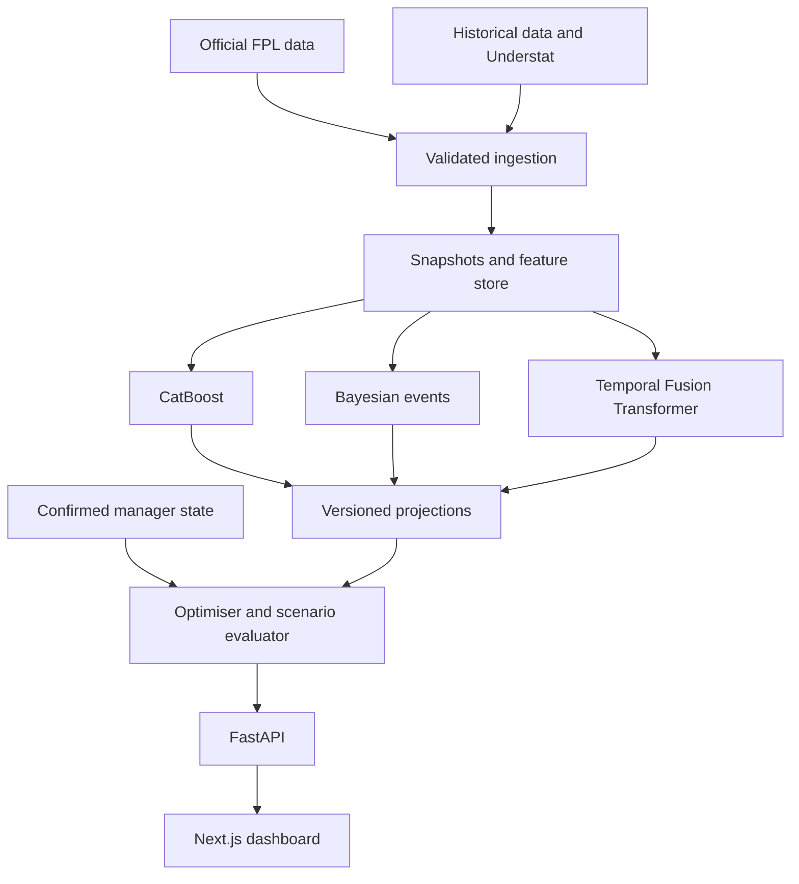

# Tech stack and architecture

These are recommended implementation choices. Framework capabilities and references are listed in SOURCES.md. Resolve compatible stable package versions at project creation and commit lockfiles. Do not assume every package's latest version is compatible with every other package.

## 1. Chosen stack

| Layer | Choice | Purpose |
|---|---|---|
| Runtime | Supported Node LTS; Python 3.12 initially | Separate interface and data modelling runtimes |
| Interface | Next.js App Router, React, TypeScript | Dashboard and planner |
| Styling | Tailwind CSS, accessible component primitives | Consistent UI |
| Server data in UI | TanStack Query | Poll jobs, cache API data, handle stale state |
| Charts | Recharts | Forecast comparisons and evaluation |
| HTTP API | FastAPI, Pydantic | Typed validation and OpenAPI |
| Python dependencies | uv | Lock dependencies and run commands |
| JavaScript dependencies | npm | Keep the first setup simple; commit package lock |
| Application storage | SQLite, SQLAlchemy 2, Alembic | Manager state, jobs, runs, plans, metadata |
| Analytical files | Parquet | Reproducible feature and training tables |
| Analytical queries | DuckDB, pandas | Historical joins and feature building |
| Source retrieval | HTTPX | Timeouts, retries, validation |
| Models | CatBoost, PyMC, PyTorch Forecasting | Three planned modelling families |
| Optimisation | HiGHS through highspy | Constrained planning |
| Python tests | pytest, Hypothesis | Rule and pipeline invariants |
| Python quality | Ruff, mypy | Static checks |
| Interface tests | Vitest, Testing Library, Playwright | Components and complete flows |

Use a supported Node LTS compatible with the chosen Next.js release; record it in `.nvmrc`. Python 3.12 is a compatibility default, not a claim that it is the latest Python release. Test native dependency installation on the actual macOS architecture.

Keep Bayesian and TFT dependencies in optional `bayes` and `deep` extras. The baseline and CatBoost path must work without downloading a deep learning environment. No OpenAI API, vector database, Kubernetes, Redis, or Celery is required initially.

## 2. Architecture



The baseline also implements the projection interface and remains available as a fallback. Forecasting, scoring, import, and optimisation modules must have independent tests.

## 3. Repository layout

Use the following logical paths. This table is a layout specification, not an assertion that files already exist.

| Path | Responsibility |
|---|---|
| `AGENTS.md` | Agent instructions |
| `docs/` | This kit, build status, decision log |
| `apps/web/` | Next.js application |
| `apps/web/src/app/` | Pages and route layout |
| `apps/web/src/components/` | Pitch, tables, corrections, plan cards |
| `apps/web/src/lib/api/` | Generated types and query hooks |
| `backend/pyproject.toml` | Base dependencies and optional modelling extras |
| `backend/src/fpl_app/api/` | FastAPI routes |
| `backend/src/fpl_app/domain/` | Rules, money, manager state, plan validation |
| `backend/src/fpl_app/providers/` | Source adapters and response schemas |
| `backend/src/fpl_app/storage/` | Database models and repositories |
| `backend/src/fpl_app/features/` | Historical feature construction |
| `backend/src/fpl_app/models/` | Baseline, CatBoost, Bayesian, TFT, ensemble |
| `backend/src/fpl_app/optimisation/` | Candidate generation and scoring |
| `backend/src/fpl_app/evaluation/` | Forecast metrics and policy replay |
| `backend/src/fpl_app/jobs/` | Worker, leases, recovery |
| `backend/src/fpl_app/cli.py` | Data and model command interface |
| `backend/tests/` | Unit, property, integration tests |
| `fixtures/demo/` | Small synthetic or appropriately sourced sample data |
| `data/raw/` | Immutable source bytes, ignored by Git |
| `data/processed/` | Parquet datasets, ignored by Git |
| `data/models/` | Local model artifacts, ignored by Git |
| `data/app.sqlite` | Application state, ignored by Git |

## 4. Runtime and network topology

During local development, Next.js listens on localhost port 3000, FastAPI on 127.0.0.1 port 8000, and one worker handles jobs. The web server proxies `/api/:path*` to the same backend path. Use one origin in the browser.

The browser never calls FPL directly. Provider requests originate from the Python server. Store source base URLs as fixed configuration, not values supplied by users. Parse a team URL to an integer ID and construct the provider URL from that ID. Do not fetch arbitrary user supplied URLs.

Bind the personal backend to loopback by default. A hosted version requires authentication, scoped manager state, and persistent storage. Local assumptions are not sufficient security for an internet accessible deployment.

## 5. Application persistence

| Table | Important fields |
|---|---|
| `source_snapshots` | ID, provider, resource, captured_at, available_at, checksum, local path, schema version, status |
| `players` | Canonical ID, season, FPL element ID, FPL code, team, position |
| `fixture_versions` | Fixture ID, snapshot ID, kickoff, event assignment, known_at |
| `manager_states` | Team ID, state version, next event, bank, transfer allowance, chip state, completeness, provenance |
| `manager_picks` | State ID, player, acquisition identity, purchase price, sell price, position, captain flags |
| `transfer_ledger` | Effective event, in/out players, price units, chip context, source, recorded_at |
| `model_runs` | Model family, artifact hash, feature version, training cutoff, seed, validation references |
| `projection_runs` | Model run, source cutoff, target events, rule version, data mode |
| `player_projections` | Run ID, player, fixture, expected points, minutes, appearance probabilities, optional intervals |
| `plans` | Input fingerprint, state version, projection run, settings, actions, score, validity |
| `jobs` | Type, payload, status, progress, attempts, lease, timestamps, result ID, error code |
| `evaluation_runs` | Dataset version, forecast IDs, metrics, policy settings, outcome cutoff |

Use explicit unknown values, represented as null plus a completeness reason. Missing bank, free transfers, or selling prices cannot be inferred as zero. Avoid using floating point numbers for money.

Enable SQLite foreign keys, WAL mode, and short write transactions. Serialize computation jobs. Avoid simultaneous analytical and application writes to the same database. Raw and Parquet artifacts are immutable and referenced by checksum.

## 6. Jobs

Long tasks return a job ID immediately. A separate Python worker claims jobs transactionally, writes a lease and heartbeat, and records results. Polling is enough; WebSockets are optional.

States: `queued`, `running`, `succeeded`, `failed`, `cancelled`.

The worker must support expired lease recovery, bounded retries, cooperative cancellation, and idempotent outputs. An API restart must not lose queued work. A duplicate request with the same input fingerprint can return an existing completed result or active job.

Heavy model training never runs during an ordinary lineup request or inside a fragile HTTP background task. Start with one worker and persistent SQLite jobs. Add external queue infrastructure only if actual hosting needs it.

## 7. API contract

All routes use `/api/v1`. Error responses have `code`, `message`, `details`, and `request_id`. Use explicit statuses and machine readable codes.

| Method and route | Request | Response |
|---|---|---|
| `GET /health` | None | API and database status |
| `GET /status` | None | Provider freshness, current season, next event, model availability |
| `POST /data/refresh` | Resources and optional force flag | Job ID |
| `GET /players` | Event, position, price, search, projection run | Paginated player records |
| `GET /fixtures` | Event range | Known fixture versions |
| `POST /teams/import` | Team ID or validated official URL | Imported state and completeness report |
| `GET /teams/{team_id}/state` | None | Current persisted state |
| `PATCH /teams/{team_id}/state` | Expected version and corrections | Validated new version |
| `POST /projections/runs` | Cutoff, horizon, model family | Job ID |
| `GET /projections/runs/{run_id}` | None | Version and projection data |
| `POST /recommendations` | State version, projection run, settings | Job ID |
| `GET /jobs/{job_id}` | None | Progress or result reference |
| `POST /jobs/{job_id}/cancel` | None | Cancellation status |
| `POST /plans` | Recommendation ID or validated custom actions | Saved plan ID |
| `GET /plans/{plan_id}` | None | Plan and stale reasons |
| `GET /models` | None | Registry and validation status |
| `GET /evaluations` | Filters | Recorded forecast and policy metrics |

The `/health` entry in the table is relative to `/api/v1`, just like every other listed route.

### Manager state example

The following is a contract fragment; a valid complete payload contains all 15 picks and the full chip state.

```json
{
  "team_id": 123456,
  "state_version": 4,
  "season": "2026/27",
  "next_event": 7,
  "public_source_event": 6,
  "data_mode": "live",
  "bank_units": 12,
  "bank_provenance": "user_confirmed",
  "free_transfers_at_event_start": 2,
  "transfers_made_this_event": 1,
  "confirmed_hit_points": 0,
  "current_chip": null,
  "picks": [
    {
      "player_id": "canonical_example_player",
      "fpl_element_id": 101,
      "purchase_price_units": 75,
      "selling_price_units": 76,
      "selling_price_provenance": "user_confirmed",
      "position": 1,
      "is_captain": false,
      "is_vice_captain": false
    }
  ],
  "readiness": {
    "lineup_ready": true,
    "transfers_ready": false,
    "missing_fields": ["selling prices for remaining players"]
  }
}
```

Use `confirmed_hit_points` for points already committed this event. Keep points and price units as distinct domain types.

### Recommendation request

```json
{
  "team_id": 123456,
  "expected_state_version": 4,
  "projection_run_id": "projection_example",
  "settings": {
    "horizon_events": 6,
    "objective": "expected_points",
    "max_additional_hit_points": 4,
    "locked_player_ids": [],
    "excluded_player_ids": [],
    "chip_policy": "none",
    "solver_time_limit_seconds": 30
  }
}
```

### Recommendation result fields

Use `baseline_plan`, `alternatives`, `source_cutoff`, `rules_version`, `state_version`, and `projection_run_id` at the top level. Every alternative includes weekly actions, bank and transfer state, gross points, total hits, incremental hits, net points, delta to baseline, explanatory components, scenario metrics if available, and solver metadata.

Display `p10_points`, `p50_points`, and `p90_points` only if an appropriate distribution exists. Quantiles are distribution percentiles, not three independent predictions or a universal confidence interval.

### Errors and concurrency

Use `404` for unknown entries, `409 STATE_VERSION_CONFLICT` for an outdated edit, `409 STALE_INPUTS` for a changed fixture or state, `422 INCOMPLETE_MANAGER_STATE` for missing financial information, and `503 PROVIDER_UNAVAILABLE` when no acceptable source exists. A failed refresh with an old snapshot can return usable data and an explicit stale warning.

Generate TypeScript types from the backend OpenAPI contract. Never maintain a second, subtly different hand written schema in the frontend.

## 8. Local commands the agent must implement

These commands are target interfaces to create, not already working commands.

| Command | Responsibility |
|---|---|
| `npm run dev` in `apps/web` | Start the interface |
| `uv run uvicorn fpl_app.api.main:app --reload` in `backend` | Start FastAPI |
| `uv run python -m fpl_app.jobs.worker` in `backend` | Start one worker |
| `uv run python -m fpl_app.cli ingest --source fpl` | Fetch and archive source data |
| `uv run python -m fpl_app.cli demo` | Load an isolated demo |
| `uv run python -m fpl_app.cli features --cutoff ISO_TIMESTAMP` | Build a dated dataset |
| `uv run python -m fpl_app.cli train --model catboost` | Train against a recorded dataset configuration |
| `uv run python -m fpl_app.cli evaluate --run RUN_ID` | Evaluate frozen forecasts |
| `uv run pytest` | Backend tests |
| `uv run ruff check .` and `uv run mypy src` | Backend quality |
| `npm run lint`, `npm run typecheck`, `npm run test` | Interface quality |
| `npm run test:e2e` | Complete flow tests |

Add a root script to launch the three local processes and shut them down cleanly. Avoid requiring Docker for local work. Pin versions and document any platform specific installation exception.

## 9. Configuration

Create `.env.example` with nonsecret example values for `APP_ENV`, `DATA_DIR`, `DATABASE_URL`, `BACKEND_URL`, `FPL_BASE_URL`, `DEFAULT_HORIZON`, `PROVIDER_TIMEOUT_SECONDS`, and `PROVIDER_MIN_INTERVAL_SECONDS`.

The backend base URL used by Next.js is server configuration. Never expose cookies or secret provider credentials through public environment variables, Git, logs, exported plans, or a browser bundle. No credential is required for the default public data mode.

## 10. Proposed performance budgets

On the user's machine, measure rather than promise: cached dashboard below two seconds, import usually below fifteen seconds when providers respond, and first optimisation within a configurable thirty second time limit. Return the best valid incumbent when a time limit is reached. These are initial engineering targets.

Cache once per resource and serve multiple analyses from that snapshot. Record provider timestamps and model runtime. Use conservative request pacing, bounded exponential backoff for retryable failures, and respect `Retry-After`. Never bypass a provider block.

## 11. Deployment path

Deliver local use first. Later, containerise the web, API, and worker with persistent volumes and backups. SQLite remains suitable for a personal serialized worker; move to PostgreSQL when concurrency or multiple users warrants it.

Treat hosting and training separately. Short lived web functions are not the default place to train PyMC or TFT models. Do not assume a frontend deployment automatically provides durable backend storage or jobs.

## 12. Reproducibility

Record source checksums, rule version, feature version, dataset cutoff, training seed, package lock hashes, artifact hash, and Git revision. Plans retain the forecast version that created them. A later refresh marks a plan stale rather than silently rewriting its history.
