# FPL intelligence upgrade: complete specification

Prepared 10 October 2026. Includes the repository audit, updated PRD, data and model design, planning improvements, social intelligence, implementation tasks and Codex instructions.

Use the individual files when implementing. This combined copy duplicates them for reading convenience.

---

## FPL intelligence upgrade kit

Prepared 10 October 2026 for Sambhav's existing FPL application. Audit baseline: `e759bcfb299d3f818d2e80ebb017796874cf8019`.

### Main conclusion

The existing app uses an approximate forecast and has useful infrastructure, but its advanced model code does not power prediction jobs. The transfer search also has a reproduced objective mismatch. Prioritise real data, evaluation, routing and planning before more visual work.

### Files

| File | Purpose |
| --- | --- |
| REPOSITORY_AUDIT.md | Evidence, limitations and 16 specific findings |
| FPL_PRD_V2.md | Updated product scope and release gates |
| ML_DATA_AND_PLANNING_SPEC.md | Data, three model families, serving, evaluation and long horizon planning |
| SOCIAL_INTELLIGENCE_SPEC.md | Semantic claims, expert versus crowd consensus, access and evidence controls |
| IMPLEMENTATION_BACKLOG.md | Twelve implementation tasks and acceptance criteria |
| CODEX_EXECUTION_PROMPT.md | Copyable execution instructions with multiple agents |
| SOURCES.md | Pinned code evidence and primary external references |
| verification/ | Portable review probes and recorded synthetic results |
| FPL_INTELLIGENCE_UPGRADE_COMPLETE.md | Combined Markdown copy for convenient reading |

### Use in Cursor

Copy this folder into the project as `docs/intelligence_upgrade/`. Do not overwrite the working source, original specifications, manager state or local data. Give Codex `CODEX_EXECUTION_PROMPT.md`.

This kit revises the forecasting, strategy and social scope of the original specifications. Current official rules and existing integrity requirements remain controlling. Compare the current branch with the audited commit before treating a finding as still present. Use the individual files for implementation; do not read the combined file again unless needed.

The first intelligence release consists of B01 through B06: reproduce and fix the funding pair miss, collect real data, evaluate CatBoost, wire the serving router and run strategy replay. Social extraction can proceed independently with synthetic examples while live access is pending.

### Verification limits

The audit parsed all 47 Python files and ran two synthetic behavioural probes against actual repository source. It did not rerun the entire application suite, train real models, or evaluate the private team. The seven point synthetic search gap is a software counterexample, not a real world performance estimate.

No model improvement, expert reliability or rank gain is claimed without future measurement.

---

## FPL repository audit

Reviewed 10 October 2026. Repository: [Sambhav255/fpl-agent](https://github.com/Sambhav255/fpl-agent). Pinned commit: `e759bcfb299d3f818d2e80ebb017796874cf8019`.

### Assessment

The project is a useful baseline application with real domain logic and substantial unfinished modelling work. It is not yet an evaluated machine learning strategy engine. Your concern about priorities is justified: the next release should prove forecasting and decision quality before adding further visual polish.

The existing model files are more than decorative placeholders. CatBoost has genuine training code, Bayesian fitting calls PyMC, and TFT fitting calls PyTorch Forecasting. However, the application prediction worker only calls the approximate baseline. There is no implemented promotion and routing path that would make a successful model training run power the planner.

Do not discard the application. Preserve its manager state corrections, unknown financial state handling, rules, immutable snapshots, recoverable jobs, version checks and independent plan validation. Improve the intelligence behind those interfaces.

### Scope and evidence

I retrieved 80 files at the pinned commit, including all 34 Python source files, 13 backend test files, selected frontend components and tests, CI configuration and current implementation notes. I traced data collection, feature construction, training, inference adapters, model registry, projection jobs, transfer search and chip advice. I ran two controlled synthetic behavioural probes against the actual checked out source and parsed all 47 Python files for syntax.

I did not execute the full project test suite, train the three model families, inspect your ignored local data, or run your personal team. This environment lacks several project dependencies. The repository reports 194 backend tests passing, three skipped tests, and 14 browser tests passing; those counts are developer recorded results rather than results independently reproduced here. A GitHub Checks run for this commit was in progress when inspected. Passing application tests would not establish forecasting or transfer performance.

All findings below describe the pinned code. Later local changes or commits need a fresh comparison.

### Findings

| ID | Priority | Finding | Evidence | Consequence |
| --- | --- | --- | --- | --- |
| A01 | P0 | Projection jobs always use the baseline | `backend/src/fpl_app/jobs/__init__.py`, `Worker.compute`, lines 318 to 330 | Training an advanced artifact alone cannot improve the live app |
| A02 | P0 | The only active forecast is heuristic | `models/baseline.py`, `baseline_run` | Forecast quality and uncertainty are not established |
| A03 | P0 | CatBoost uses ten lagged numeric inputs | `features/pipeline.py`, `NUMERIC_FEATURES`, lines 41 to 52; `models/training.py`, `train_catboost` | Opponent, venue, position and fixture context are absent from its actual training matrix |
| A04 | P0 | Search can miss valuable funding combinations | `optimisation/planner.py`, `_highs_candidate` and `recommend`; reproduced below | A solved proxy is not the best legal transfer plan |
| A05 | P0 | No integrated strategy replay exists | `evaluation/metrics.py` contains forecast metrics and ensemble fitting, but no evolving manager policy evaluator | There is no evidence that recommendations beat simpler policies after hits |
| A06 | P1 | Beam pruning uses accrued points | `optimisation/planner.py`, lines 389 to 403 | Paths with an immediate sacrifice can disappear before their future benefit is assessed |
| A07 | P1 | Current availability persists throughout the horizon | `models/baseline.py`, probability set outside fixture loop | An injury flag for the next match can suppress a player for eight events |
| A08 | P1 | Future chip use is not jointly optimised | `optimisation/planner.py`, `event_chip = chip if offset == 0 else None`; `optimisation/advice.py` | Present advice cannot support an integrated season game plan |
| A09 | P1 | Scenario information is lost before planning | Bayesian sampler produces joint outcomes, adapter returns marginal projections, planner uses scalar means | Correlated outcomes, automatic substitutions, captain fallback and downside cannot guide decisions |
| A10 | P1 | Bayesian scoring and minutes are incomplete | `models/bayesian.py`, `shared_scenarios` | Team goal forecasts are not a complete calibrated FPL points model |
| A11 | P1 | TFT is restricted to one event | `models/tft.py`, `max_prediction_length=1`; strict adapter rejects longer horizons | Its name does not imply implemented forecasting across multiple future events |
| A12 | P1 | Historical provenance is a bottleneck without a practical collection plan | `features/archive.py`, `features/pipeline.py`, `docs/ML_INTEGRATION.md` | The project can remain indefinitely blocked while waiting for an ideal historical bundle |
| A13 | P1 | Evaluation is too narrow | `models/training.py`, `split_panel`; `evaluation/metrics.py` | The final two event cutoffs provide a small test window; broad performance is unknown |
| A14 | P1 | Promotion eligibility is always false | `models/registry.py` and `models/training.py`, `evaluate_run` | A trained or evaluated badge cannot become an operational champion |
| A15 | P1 | No social intelligence implementation | No Reddit, X, claim extraction or consensus modules in the complete tree | The requested expert and crowd evidence layer requires a new subsystem |
| A16 | P2 | Product emphasis favours the current event | `apps/web/src/components/planner/optimum-card.tsx`, heading “Optimum move” | The principal interface can draw attention away from the stronger horizon policy |

P0 means required for the next trustworthy intelligence release. P1 means required for the broader strategy release. These are review priorities, not measured performance scores.

### Reproduced transfer search failure

A synthetic one event case has 18 players, a legal 15 player owned squad, two free transfers, zero bank, and no permitted additional hits. It uses plausible purchase prices of £4.5m, £5.0m and £5.5m.

| Plan | Expected points | Action |
| --- | --- | --- |
| Keep | 84 | Keep the owned squad |
| Best returned by current planner | 94 | Replace one goalkeeper with a goalkeeper upgrade |
| Best exhaustive legal plan | 101 | Sell reserve goalkeeper for £5.0m, buy £4.5m reserve, use released £0.5m to upgrade a midfielder |

The seven point gap is a controlled software counterexample, not an estimate of real world losses. The existing solver had time remaining and reported an optimal candidate proxy with zero proxy gap. That gap describes its own linear squad objective, not the complete recommendation problem.

The proxy maximises the sum of points from all 15 owned players. Downgrading a bench goalkeeper looks costly under that objective, although the retained first goalkeeper can still start. The candidate menu contains all single transfers and only a small number of proxy generated transfer bundles. It therefore misses the beneficial pair. This is a direct reason to solve squad ownership, starting lineup and captaincy together.

Reproduction is provided in `verification/audit_probes.py`, with output in `verification/audit_probe_results.json`. The portable probe takes the actual project root as its argument and imports that project's `backend/src` code. Run it through the project environment as documented in the verification README. Do not treat this script as a replacement for the project regression suite.

### Reproduced availability limitation

For a synthetic player with current availability equal to zero, the baseline emits zero expected points and zero expected minutes in every event from GW8 through GW15. The code intentionally freezes snapshot availability, and discloses this assumption. It has no recovery trajectory.

Build event specific availability from public return information and calibrated recovery scenarios. Do not assume recovery merely because several weeks pass. Distinguish a probability for the next match from a permanent removal or suspension duration.

### What the model code actually does

#### Baseline

It blends a shrunk points per appearance reference with approximate appearance, goals, assists, clean sheet and constant bonus components. Fixture difficulty and home advantage are hand chosen adjustments. Defensive contributions, cards, saves and concessions are missing from the component forecast. This may be a useful comparator, but it is not a trained or calibrated forecast.

#### CatBoost

There is a real mean regressor and auxiliary classifiers for appearance, 60 minute exposure and starts when labels exist. The mean target is unconditional, which is appropriate. However, the feature list omits much of the football context already present elsewhere in the panel. The inference adapter derives minutes from a lagged average, does not supply calibrated point distributions, and is not connected to prediction jobs.

#### Bayesian events

The team goal model is genuinely hierarchical and samples a shared match score. This is a useful foundation for correlated clean sheet and attacking outcomes. Player minutes use a heuristic 20 or 80 minute mixture, and goalkeeper selection is simplified. Full BPS, defensive contribution, saves and disciplinary outcomes are missing. Full match concessions are used even where a player's on pitch interval should matter. Preserve the joint scenario idea and complete it before treating these points as comparable with a full FPL target.

#### TFT

The implementation genuinely fits separate mean and quantile heads and makes an effort to preserve deadline information and fixture slots. It is a compact CPU model with a one step decoder. Opponent IDs are currently treated as numeric inputs. It needs categorical football context, a genuine decoder across the supported horizon, proper target masking, held out evaluation and an operational serving path.

#### Ensemble

Convex weight fitting exists as a utility. It is not an active ensemble service. An ensemble fitted on validation data is not automatically better outside that data. Weight fitting and champion selection need separate tests and uncertainty reporting.

### Historical data correction

The Vaastav repository currently says weekly updates stopped after 2024/25, with three larger updates per subsequent season. It is an archive source, not a dependable weekly collection service. It also explicitly warns that its `xP` field may reflect information collected after matches. The current exclusion of unverified historical xP is sensible. See [dataset notice](https://github.com/vaastav/Fantasy-Premier-League).

Do not remove the honesty gates to manufacture eligibility. Instead add distinct modes for historical reconstruction, research experiments, prospective shadow forecasts and deployed forecasts. Historical fitting performed today can be a valid retrospective experiment if its input cutoffs are respected. It must not claim that the artifact existed at the historical deadline. Conversely, final historical observations already known today can legitimately be used to train a model for a future deadline, even when their exact original publication timing is uncertain. Such a model still needs honestly qualified evaluation before becoming the default.

### What to retain

1. Financial fields stay unknown until confirmed.
2. Money remains integer tenths with separate acquisition and selling values.
3. Plan validity is checked independently after solving.
4. Source and manager state versions invalidate stale plans.
5. Synthetic demo data is separated from real training and performance claims.
6. Long jobs remain recoverable and optional model dependencies remain optional.

### Recommended next release

Freeze cosmetic work. Ship an evaluated football forecast, a lineup aware planning objective, a real prediction router, and a reproducible strategy replay report. Start collecting future deadline snapshots immediately. Build social extraction and expert/crowd summaries independently, with no automatic forecast adjustment until permissions and usefulness are established.

Success means the application can answer: “Which action is best now, why does it help over the coming events, when would that recommendation change, and what evidence supports the forecast?” It does not mean that all three model names appear on a page.

---

## FPL strategy assistant PRD v2

Owner: Sambhav. Date: 10 October 2026. Basis: repository audit at commit `e759bcfb299d3f818d2e80ebb017796874cf8019`.

### Product decision

Build a personal FPL decision system that improves forecasting, transfers and the overall game plan. Preserve the existing application and prioritise intelligence and measurable decision quality. This document updates the modelling, planning, evaluation and social scope of the original PRD. Existing rules, state integrity and manual execution requirements remain applicable.

The three forecast families remain CatBoost, Bayesian football events and TFT. Implement and compare all three. Deploy the best eligible individual model or subset ensemble. Do not require a weak model to be included merely to reach a count of three.

### Primary outcome

Before a deadline, the user receives a legal immediate action, an explained plan across upcoming events, conditional future actions, captain and bench decisions, chip opportunities, and separate summaries of expert opinion and crowd consensus. Every forecast and plan carries its source, timing, evidence quality and limitations.

The main objective is expected FPL points after hits. Optional modes assess downside or a specific mini league objective. Popularity, account follower counts and general positive sentiment do not directly become expected points.

### Scope by horizon

| Horizon | Purpose | Required output |
| --- | --- | --- |
| Current deadline | Concrete decision | Roll or transfer, exact costs, lineup, captain, vice captain, bench and timing |
| Next eight events | Detailed planning | Transfers by event, bank and free transfer paths, net value and contingencies |
| Next eight to twelve events | Strategic watchlist | Fixture turns, potential restructuring and uncertainty; twelve event solving is an extension requiring contract and forecast support |
| Remaining chip windows | Macro strategy | Candidate Wildcard, Free Hit, Bench Boost and Triple Captain windows with calendar scenarios |

A future transfer is a contingent proposal. Recompute after new information. Do not present a fixed path as a promise that the same player will remain best in six weeks.

### Users and core questions

The first user is Sambhav managing one standard FPL team. Support an imported deadline squad plus manually confirmed current state. The product should answer:

1. Should I roll, use one transfer, use a funding pair, or take a hit?
2. Is the current event favourite still best over the whole horizon?
3. Which transfer preserves an upgrade route to a future captain?
4. What changes if an injury, rotation risk, price move or fixture postponement occurs?
5. Where should my chips fit into the current window?
6. What do credible football sources, FPL analysts and the sampled crowd agree or disagree about?
7. Does the social evidence add useful information beyond football statistics?

### Functional requirements

#### Forecasting

F01. Produce a frozen forecast for each eligible player and scheduled fixture, plus event totals. Include unconditional expected points, expected minutes, appearance probability, start probability, 60 minute probability and uncertainty when calibrated.

F02. Model opponent and club strengths, venue, recent and longer performance, role and set pieces, minutes trends, congestion, season scoring regime, and event specific availability. Add xG and xA only through a source with suitable access and timestamp evidence.

F03. Make model lifecycle explicit: implemented, trained, retrospectively evaluated, shadow, eligible, active, disabled. The active model must be the one actually used by the worker. Identify model artifact, feature version and mappings in every result.

F04. Support an approximate baseline and independent simple comparators. Optional model failures must not fabricate a successful advanced forecast.

F05. Provide calibrated joint scenarios for risk calculations and nonlinear squad scoring. Marginal point quantiles alone do not justify a probability that one plan beats another.

#### Transfer and strategy engine

P01. Optimise ownership, starting lineup, captaincy, transfers and finances across events. Correct the reproduced funding pair failure.

P02. Compare Keep, Roll, best immediate action, best horizon policy, and meaningful alternatives. Separate additional hits from already committed hits.

P03. Value free transfer inventory and future flexibility beyond a final tie break. Compare longer horizons and terminal policies to expose horizon artefacts.

P04. Search multiple transfer bundles and chip dates. Include future chip actions rather than restricting chips to the first event. Independently replay every returned plan.

P05. Compare scenario distributions using the same simulated football outcomes for all plans. Include legal automatic substitutions and vice captain fallback.

P06. Return triggers such as “buy only if start probability exceeds the validated threshold” or “this route requires the price to stay below £X”. Derive thresholds from the planner, not invented text.

P07. Compare waiting for information with making an early transfer under price and availability uncertainty. If a reliable price forecast is absent, show affordability scenarios rather than an asserted rise probability.

P08. Keep strong current financial gates. If money is unknown, provide lineup advice and clearly conditional affordability information, without labelling a transfer budget valid.

#### Social intelligence

S01. Add approved Reddit and official X ingestion adapters. Access and spending remain disabled until configured. The baseline and football models work without either provider.

S02. Resolve posts to player IDs, action, topic, event horizon, certainty and evidence. Distinguish factual reports from opinions, questions, jokes, team reveals and copied claims.

S03. Separate official football information, specialist club reporters, FPL analysts, established FPL managers and the ordinary crowd. Membership of a source category is reviewed and versioned, never inferred solely from popularity.

S04. Rank sources within their expertise using past verifiable claims and uncertainty. A football injury reporter and a good FPL manager have different areas of expertise.

S05. Show independent expert and crowd summaries for buy, sell, hold, captain and avoid stances. Include coverage, distinct authors, effective sample size, disagreement and source recency. These describe sampled sources, not all FPL managers.

S06. Collapse copied articles and repeated rumours into one evidence family. Cross platform amplification does not create independent confirmation.

S07. Initially use social information as an explanatory layer and a watchlist trigger. Enable quantified forecast changes only after source permissions, calibration and prospective evaluation support them.

S08. Missing or stale social coverage remains unavailable. It does not become neutral sentiment.

#### Evaluation and explanations

E01. Freeze all features by the forecast origin and separate fitting, model selection, ensemble fitting and final evaluation periods.

E02. Compare both forecast accuracy and realised strategy points after hits. Evaluate multiple starting squads and seasons or scoring regimes with explicit coverage limitations.

E03. Explain the numerical decision using football components, minutes, hits, opportunity cost and uncertainty. A language model may summarise structured outputs but must not select players or invent probabilities.

E04. Keep a prospective deadline journal that records predictions and recommendations before results. Reproduce each report from immutable input references.

### Decision report contract

| Section | Content |
| --- | --- |
| Immediate action | Exact transfers or roll, costs, hits and current squad legality |
| Horizon comparison | Expected incremental points against each named comparator |
| Conditional plan | Future route, alternative branch and invalidation triggers |
| Team selection | Legal formation, captain, vice captain, bench priority |
| Chip strategy | Marginal value of spending versus preserving each available chip |
| Football evidence | Minutes and scoring drivers, fixture effects, data coverage |
| Expert view | Reviewed source category, stance, evidence and disagreement |
| Crowd view | Sample scope, stance, breadth, recency and uncertainty |
| Model confidence | Eligible model, validation status, horizon support and distribution status |
| Timing | Forecast origin, source cutoffs, stale conditions and refresh instructions |

Use an explicit unavailable state for any section whose evidence is insufficient. Example figures in fixtures or demo reports must be labelled synthetic.

### Release gates

| Gate | Requirement |
| --- | --- |
| Correctness | All returned plans pass independent financial, squad, formation and chip replay |
| Forecast integrity | No future features, target revisions or model selection leakage at a claimed origin |
| Serving | Selected eligible artifact demonstrably changes projection job outputs |
| Search quality | Small deterministic test universes match an exhaustive oracle; full problems report actual solver limitations |
| Research evidence | Reproducible chronological comparison against declared baselines, with uncertainty and subgroup results |
| Default promotion | Evaluation supports usefulness; prospective forecasts support deployment readiness; no claimed superiority without evidence |
| Social launch | Access is authorised for the intended processing, missing providers degrade cleanly, extraction quality is measured |
| Social forecast influence | Additional predictive or decision value demonstrated separately from the football only model |

Do not promise a percentage gain or a rank target before measurement. Predeclare practical tolerances and statistical tests before looking at the final test period. A model that fails to improve the default can remain an honest research challenger.

### Priorities and boundaries

P0: fix objective mismatch, add real model routing, collect deadline data and produce a baseline versus CatBoost evaluation and strategy replay.

P1: complete minutes and scoring, add robust planning and future chip dates, implement expert and crowd summaries, and evaluate Bayesian scenarios.

P2: implement TFT across the supported horizon, eligible ensemble weights, social signal ablations and optional mini league objectives.

Defer new navigation, decorative charts, visual redesigns, generic chat, automatic transfer submission, paid football data purchases and social posting. Small interface changes needed to expose real model selection, evidence or conditional plans are within scope.

### Product metrics

Measure forecast error and calibration by event, position, price tier and appearance class; strategy points after hits versus Keep, greedy transfers and the existing planner; transfer regret against a small universe oracle; probability that a recommendation changes under plausible input perturbations; runtime and valid incumbent rate; minutes forecast error; extraction and source classification quality; and provider cost.

Also measure paired strategy comparisons with a common transfer flexibility policy. A frozen Keep comparator alone overstates the value of a strategy that keeps receiving new information and making transfers.

### Acceptance scenario

Given a confirmed squad and frozen sources, the system can recommend rolling now to enable a future funding pair, show why the horizon policy differs from the immediate favourite, identify a chip opportunity, and explain whether expert disagreement changes its assumptions. The same recommendation can be reconstructed later. If no evaluated advanced model is eligible, the report explicitly says it uses the baseline.

---

## Forecasting, data and planning specification

Date: 10 October 2026. Companion to `FPL_PRD_V2.md`. Existing contracts are extended through versioned migrations and generated frontend types. Preserve the current local stack.

### Architecture

Keep Next.js, TypeScript, FastAPI, SQLite, Parquet, uv, CatBoost, PyMC, PyTorch Forecasting and HiGHS. Add scikit learn for calibration and evaluation where appropriate. Use the existing worker and local artifact registry before introducing new infrastructure.

```mermaid
flowchart TD
  A[Football sources] --> C[Versioned feature store]
  B[Approved social sources] --> D[Claims and consensus]
  C --> E[Forecast families]
  E --> F[Eligible model router]
  F --> G[Joint scenarios]
  G --> H[Transfer and chip planner]
  C --> H
  D --> I[Evidence report]
  H --> J[Independent replay]
  J --> I
  K[Historical and prospective evaluation] --> F
  K --> H
```

Social facts may enter a future forecast adapter only after permitted use and validation. That optional connection is deliberately absent from the initial production path.

### 1. Data acquisition

| Source | Use | Implementation |
| --- | --- | --- |
| Official FPL bootstrap | Player identity, position, prices, availability, available aggregate fields and deadlines | Reuse provider; retain raw versions and normalised observations |
| Official fixtures | Schedule, venue, completion and event allocation | Reuse provider; retain every changed version |
| Official element summary | Fixture histories and prior season summaries | Add bounded collection for the candidate universe, prioritising owned and likely transfer players |
| Public manager endpoints | Published squad and history | Preserve existing import and confirmation flow |
| Vaastav archive | Historical labels and audited historical experiments | Pin source commit and checksums; do not rely on weekly updates |
| Official club and league statements | Public availability and football role information | Collect only through supported access, retaining source links and time evidence |
| Optional licensed football source | Richer match events, xG, xA and lineups | Provider interface; no dependency on access that has not been obtained |
| Approved social providers | Claims and sampled opinion | Separate capability and retention controls from immutable football snapshots |

Start a prospective collector now. Default capture schedule: periodic fixture and bootstrap refreshes, plus snapshots around each deadline and after official event finalisation. The exact cadence is configurable and respects provider limits. A daemon only gathers while it is actually running; do not claim missed deadlines were captured.

The 2026/27 official update says event scores now finalise at 09:00 UK time on the day after the last match. Preserve preliminary and final label versions instead of assuming final points are available three hours after kickoff. Use the real event lock state or verified published finalisation where available. Sources are in `SOURCES.md`.

#### Observation envelope

Record provider, resource, provider IDs, canonical IDs, season, event, fixture, schema version, payload checksum, captured time, asserted source publication time, earliest observed time, evidence reference, and revision status. Separate the time a match happened from the time its statistics became usable.

Use canonical person and club mappings with provider and season namespaces. Resolve aliases through explicit mappings. Name similarity proposes a mapping; it does not approve one. Player club, FPL position and eligibility are temporal attributes, especially after transfers and seasonal reclassification.

#### Evidence modes

| Mode | Meaning | Permitted claim |
| --- | --- | --- |
| Retrospective assumed | Final archive with conservative lag assumptions | A qualified historical experiment |
| Retrospective reconstructed | Retained input versions with origin evidence | A reconstruction with explicit coverage and remaining uncertainty |
| Prospective shadow | Inputs and predictions actually frozen before outcomes | A contemporaneously recorded challenger forecast |
| Deployed | Eligible artifact routed into real recommendations | The named model actually powers the app |

Keep separate fields for `information_cutoff`, `executed_at`, `artifact_available_at` and `prediction_origin`. Historical replay executed today must never backdate its execution or artifact availability. Its validity depends on which information the simulated fitting process and forecast origin are allowed to use. Live serving additionally requires the artifact to have existed before the live decision origin.

A final historical label can be known today and eligible for fitting a future live forecast. Lack of its original publication version limits historical evaluation claims rather than proving it is unusable forever. Keep the default champion gate strict while allowing honest experimental and shadow modes.

Do not trust a self supplied `timing_verified=true` field as sufficient provenance. Bind it to retained evidence and a documented audit rule. Git commit dates alone are not proof of original publication. Record coverage and conflicts rather than silently manufacturing timing.

### 2. Panels and features

Maintain fixture level labels for scoring and event level rows for planning. Blanks, doubles, absent players, unlisted outcomes and true zero minutes are different states. Produce every eligible scheduled exposure needed by the serving universe. Missing observations never become an assumed nonappearance.

#### Proposed features

| Group | Examples | Timing rule |
| --- | --- | --- |
| Identity and rules | Position, club, age of role observation, season scoring regime | Known at origin; season scoped |
| Recent performance | Weighted minutes, starts, points, goals, assists, xG and xA where available | Only completed observations available at origin |
| Longer priors | Shrunk per 90 attack rates, goalkeeper save rates, defensive action rates | Partial pooling; missing coverage visible |
| Fixture | Opponent attack and defence, venue, days to kickoff, event slot | Frozen schedule version |
| Congestion | Rest days, recent workload, known domestic and European schedule | Future schedule allowed; future outcomes prohibited |
| Role | Set pieces, penalties, recent position, substitution patterns | Versioned evidence with expiry |
| Availability | Next event probability, confirmed absence duration, recovery scenarios | Event specific; distinguish provider scope |
| Club strength | Time varying team ratings, expected goals conceded | Estimated using prior usable matches |
| Market context | Price and ownership when justified | Historical snapshots only; keep out of causal performance claims |

Use categorical position, club, opponent and scoring regime rather than arbitrary continuous IDs. Compute priors and normalisers on fitting data only. Retain feature definitions, missingness indicators and per row source references. Audit whether prices and ownership improve forecasts or merely identify historically successful players.

Historical points have different scoring regimes. Train with an explicit rule era and compare recent era performance. Where full match statistics exist, a separate target may rescore them under current rules. Do not infer absent defensive action or BPS inputs as zero to invent a complete current rules label.

For horizon forecasts, create rows for each future fixture from the same current origin. Unknown future form, injuries and lineups are latent quantities. Do not reuse realised future rows as decoder inputs.

### 3. Model A: CatBoost football forecast

First deliver a strong tabular model. Replace the ten input training matrix with the audited football features above. Keep simple baselines as competitors.

Train an unconditional full points mean head. Separately estimate appearance, starts and minute exposure. For minutes, use a mixture with no appearance, short appearance, regular start and long start states, or a calibrated distribution that reflects those states. Validate the 60 minute threshold explicitly. A player with 55 expected minutes is not equivalent to certainty of a 55 minute appearance.

Add quantile heads or a validated distribution model. Keep expected mean separate from median. Calibrate auxiliary probabilities on a calibration period that was not used to fit the underlying model. Preserve coherent constraints such as probability of 60 minutes not exceeding probability of appearance.

For longer horizons use horizon indicators, frozen fixture features, club and role priors, and explicit future availability scenarios. Measure error separately at each lead time. A repeated current forecast is a baseline comparator, not a validated longer horizon model.

Use real football data for training. Synthetic installation tests only prove the implementation can fit and reload. Feature attribution can explain which inputs affected a forecast; it is not a causal explanation of player performance.

### 4. Model B: Bayesian events and joint outcomes

Retain hierarchical team attack and defence and shared match scores. Add temporal team evolution, season transition and promoted club priors. Unseen clubs need explicit uncertain priors, not an automatic rejection that disables all fixtures involving them.

Replace heuristic minutes with calibrated player and role distributions. Joint player scenarios should obey football exposure constraints sufficiently to produce credible substitutions and correlations. Account for goalkeeper rotation or replacement rather than assuming every chosen goalkeeper always plays 90 minutes.

For scoring, cover goals, FPL assists, clean sheets on the relevant playing interval, concessions, saves, penalties, discipline, own goals, defensive contribution and bonus. Several components can initially be calibrated empirical residual distributions. Mark approximation and test against full point labels; do not present a partial sum as a full scoring model.

Conserve shared match goals, avoid impossible self assists, and keep represented and unrepresented player allocations explicit. Do not equate a posterior parameter interval with the outcome distribution of FPL points.

Save joint scenario arrays with player IDs, fixtures, origin, artifact references and seed. Use common draw IDs across players and plans. Check convergence, posterior predictive fit and held out point calibration. Add priors for injury persistence and rotation across events rather than assuming independent appearances every week.

### 5. Model C: TFT across future events

Extend the compact one event model into a genuine decoder for the supported horizon. Use a representation that preserves multiple fixtures in an event, blank events, missing target observations and known schedule context.

Recommended first implementation: one player series over event indices, with future known fixture slots and masks, event total points as the primary target, and a documented fixture decomposition for scoring. Alternatively retain fixture slots with a tested event aggregation rule. Do not add marginal quantiles of two fixtures as if the result were an event quantile.

Supply categorical identity and role context, club and opponent information, minutes history, prior performance, horizon position, known schedule and missingness. Future observations are masked. Train preprocessing only on the fitting partition. Handle new player and season groups explicitly without pretending they are well represented.

Persist best validation checkpoints, hyperparameters, data and code hashes, preprocessing and decoder schema. Evaluate the mean and quantile heads on an untouched test period and in shadow forecasts. Start with bounded CPU experiments; increase model capacity or compute only when the data and measured results justify it.

### 6. Ensemble and serving

Introduce a `ForecastProvider` interface with supported horizons, required features, lifecycle state and an immutable artifact reference. Route prediction jobs through a resolved provider instead of directly calling `baseline_run`.

Eligibility binds the artifact checksum, training information boundary, evaluation report, feature version, mapping version, supported scoring rules and horizon. Requested selection is distinct from resolved selection. Persist the resolved provider in the job input fingerprint. If it is unavailable, return a clear error or an explicit recorded baseline fallback, never a silent advanced model badge.

The CatBoost serving path should enforce the same artifact timing and mapping rules as Bayesian and TFT. Existing adapters differ in their checks; standardise them through the router.

Fit ensemble weights only from chronological out of fold development forecasts. Use shrinkage and compare with the best single model. Assess calibration and strategy impact. Average means only when definitions and targets agree. For distributions, use a calibrated joint construction or compatible scenario mixture. Do not average or add quantiles and call that a joint outcome model.

#### Lifecycle

`implemented → trained → retrospectively_evaluated → shadow → eligible → active`

Disabling is possible from any operational state. Promotion is an explicit recorded decision with evidence, not the presence of an `evaluation.json` file. Keep champion and challenger versions, rollback and shadow comparison. A challenger may be trained on real data and remain ineligible for the default recommendations.

### 7. Forecast evaluation

Use expanding or rolling chronological folds with at least one broad held out period. Reserve the final evaluation before tuning. Use at least two completed seasons where available, plus the current scoring era, while reporting coverage. Calendar folds span scoring eras carefully; pooled results cannot hide a weak current era.

Use a separate calibration set or nested chronological calibration. Include validation outcomes used by early stopping within the fitted model's information boundary. Do not use the final test repeatedly to select models.

Compare against zero or simple population prediction where appropriate, rolling points, a shrunk minutes and event model, the existing live baseline, and any external projection whose access and historical origin evidence are suitable. A mean points comparator alone is insufficient for evaluating a football aware forecast.

| Target | Metrics |
| --- | --- |
| Full points mean | MAE, RMSE, bias, event ranking, position and price subgroup error |
| Minutes | MAE, no appearance and short appearance classification, 60 minute calibration |
| Probabilities | Brier score, log loss, reliability curves and uncertainty by subgroup |
| Distributions | Pinball loss, interval coverage and sharpness, proper distribution scores when samples exist |
| Decision relevance | Captain choices, replacement candidate ordering and realised incremental squad points |

Include errors for likely starters and transfer candidates separately. Thousands of low point unused players should not make a forecast look useful for captain selection merely by dominating the metric average.

Use event or contiguous event block resampling for paired differences. Cross event dependence and multiple comparisons limit strong conclusions. Predeclare comparisons and report uncertainty. A narrow positive point estimate is not a guarantee of superiority.

### 8. Strategy replay

Add an evaluator that evolves a legal manager state at each origin, calls a policy using only information then available, applies its immediate actions, scores the actual event with correct substitutions and chips, advances money and transfer inventory, and repeats.

Run several starting squads and conditions. Comparators: frozen Keep, refreshed greedy transfer policy, existing planner, new planner on the same forecasts, and new planner on each forecast family. This separates improvements caused by forecasts from improvements caused by search.

Use an oracle only on small deterministic test universes. It proves search correctness for those cases and is not a deployable hindsight strategy comparator.

Historical state replay requires prices, eligibility, scheduling and scoring versions. If only final snapshots exist, state the assumption and classify the evaluation accordingly. Do not claim a fully realistic policy backtest from the current lagged archive alone.

Primary outcomes: realised points after hits, paired incremental points, worst event blocks, chip uplift, transfer count, decision stability, legality and runtime. Rank claims require a suitable independently modelled field. Forecast net points and realised net points are separate report columns.

### 9. Planning formulation

For each player and event, include binary ownership, starting lineup, captain, vice captain and buy and sell variables. Include chip activation, bank, free transfer inventory, acquisition price and persistent Free Hit state. Model the exact season transitions through independently tested functions or a validated linearisation.

Ownership evolves from prior ownership plus purchases minus sales. Starting lineup is a legal subset of ownership. Captaincy belongs to the starting lineup. Each event satisfies position counts, club limits, liquidity, permitted transfer counts, chip windows and one chip per event.

Prices distinguish market purchase cost and selling proceeds. Sale proceeds depend on the player's acquisition state. Start with frozen price forecasts and disclose them; add explicit price paths later. Do not sell at market value when the owned player has a lower selling value.

Free Hit uses temporary ownership and restores the correct persistent squad and bank. Wildcard updates permanent ownership. Both preserve transfer inventory according to the verified season rules. Chip opportunity cost extends beyond the current event and beyond the detailed forecast horizon.

The deterministic objective must score the starting lineup and captain, plus bench players only where scoring rules or expected substitutions justify them. This addresses the reproduced seven point miss. Bench value is not the sum of all bench point means.

For scenario evaluation define incremental net points `D_s(P)` of plan P relative to the same comparator on shared scenario s. A proposed risk objective is:

`mean(D_s(P)) − λ × CVaRα(max(0, −D_s(P))) + continuation_value(P)`

This is an explicit user preference for downside relative to the comparator. Default λ is zero. Calibrate or sensitivity test continuation value; do not add arbitrary bank points. Scenario results describe the model's uncertainty, not a proven probability of real world success.

First actions must be identical across scenarios. Later contingent actions depend only on information revealed by that event. A scenario optimiser with different first transfers per realised future outcome is a clairvoyant oracle, not a useful policy.

### 10. Search and horizon quality

Implement a deterministic multi event MILP as the next search benchmark. Add diverse near best solutions using cuts or constrained resolves. Validate each through the independent rules engine. Compare complete squad and lineup objectives with exhaustive enumeration in small universes.

If bounded beam search remains useful, score partial states with a forward value estimate, preserve different bank and free transfer states, include explicit funding bundles, make width configurable and reserve time across the horizon. Return search coverage and incumbent history. A zero gap for a candidate proxy never becomes a global plan gap.

Then evaluate candidate policies with joint scenarios. A practical local design can use MILP for candidate construction followed by Monte Carlo reranking with adaptive sample counts. Keep the limitations of this decomposition visible. Report simulation uncertainty and use common random draws.

Default detailed horizon: eight events. Compare four, six and eight event decisions. Expand to twelve only after contracts and lead time forecasts support it. Fit or benchmark terminal free transfer and bank values using continuation rollouts on development data. A reserve budget for a future premium player is an interpretable constraint, not an unfitted universal reward.

Enumerate feasible chip dates within the current window and evaluate restructuring paths. When detailed forecasts do not reach a later chip date, use explicitly approximate macro scenarios. Consider the chip expiration cost at GW19 and season end. Avoid endlessly recommending “save” just because the last eligible event is outside the visible horizon.

### 11. Deliverable contracts

Extend `ProjectionRun` with artifact and eligibility IDs, feature and mapping versions, actual prediction origin, requested and resolved provider, supported horizon, data evidence mode, scoring version, evaluation reference and optional joint scenario reference.

Extend recommendation output with named comparator, horizon expected delta, current event delta, conditional action branches, chip calendar, affordability and probability thresholds, search coverage, input sensitivity, simulation error and actual model provenance.

Use nullable unavailable fields for uncomputed uncertainty. Keep financial readiness gates and state version checks. A saved plan references exact model and source artifacts so later reruns do not silently use updated predictions.

### 12. Verification priorities

Add regression cases for the funding pair counterexample, a beneficial short term sacrifice, roll versus a hit, horizon reversal, terminal inventory value, legal doubles and blanks, current injury versus later recovery scenarios, captain absence and vice fallback, bench order under correlated nonappearances, future chip dates, Free Hit restoration, and uncertain price affordability.

Add data tests for all future feature columns, known decoder covariates, revised labels, transfer and position mappings, missing outcome coverage, rule regime changes and historical execution versus simulated origin timing. Add a serving test proving different eligible artifacts produce different projection jobs and remain reproducible after a worker retry.

---

## Expert and crowd intelligence specification

Date: 10 October 2026. Goal: extract football evidence and FPL recommendations from approved sources, show sampled consensus, and test whether those signals improve decisions.

### 1. Product principle

Semantic analysis should identify what someone means about a player, not merely whether a sentence sounds positive. An expert consensus is a description of a reviewed source sample, not proof of truth. A crowd consensus is not representative of every FPL manager.

Keep four distinct outputs: football facts, expert strategy stance, crowd strategy stance and model prediction. Do not compress these into one invented player rating.

### 2. Source access and implementation modes

| Provider | Current verified constraint | Product design |
| --- | --- | --- |
| Reddit | Explicit approval required for API access; intended use must be disclosed; training and other uses have separate restrictions | Build an adapter and apply for the exact external analytics use case; default disabled |
| X | Official API offers recent and archive search; reads are metered; training restrictions apply | Use official API with a spend cap; default disabled |
| Licensed or permissioned contributor material | Rights depend on the agreement | Accept only the processing and retention actually covered |
| Synthetic text examples | Created for testing | Exercise extraction and interface without implying live coverage |

Reddit's current Responsible Builder Policy says uses not supported by Devvit require a request, and commercial use requires explicit written approval. Do not assume that registering OAuth credentials or installing PRAW grants access to this analytics project. Research program access is a separate route and not a substitute for approval of a personal application.

X's official pages currently list post reads at $0.005 per returned resource and user reads at $0.010. Thus 5,000 new billable post reads cost approximately $25, excluding profiles, extra resources and inference. Treat that as a planning example, not a promised bill. Set both an app budget and the provider spending limit. Deduplication can reduce repeated read charges, but local caching and hard caps are still needed. Verify pricing when enabling the connector.

Recent X search covers seven days. Full archive access is separately available through the current paid access model. Starting a collector today cannot produce an honestly observed historical stream for previous deadlines.

Build provider capability flags for `allow_read`, `allow_store`, `allow_inference`, `allow_external_processing`, `allow_derived_features`, `allow_training`, and retention. Rights to fetch are not automatically rights to train a model. Initially prohibit fitting classifiers, points models or expert weights on restricted content unless the intended use is explicitly covered. Derived numeric features are not an automatic workaround.

Inference with an existing model is a separate activity from fitting or fine tuning. Verify that the intended inference, storage and any third party processing are allowed before activation. Prefer local processing when it fits the approved use case. Do not send source text to an external model by default.

Social content must support edits and removals. Do not copy the immutable forever retention policy of football snapshots. Retain tombstones and lineage sufficient to purge text, embeddings, derived claims and affected aggregates when required. Recompute affected summaries and record changes according to permitted retention.

These requirements come from current platform documentation in `SOURCES.md`. They do not require the product to stop functioning while access is pending: football forecasts and synthetic extraction tests remain usable.

### 3. What to collect

Reddit starting scope, if approved: r/FantasyPL and relevant analytical discussions; captain polls, injury threads, press conference discussion, transfer advice and team reveals. Other communities require the same access coverage and a clear reason to include them.

X starting scope: a reviewed registry of official club sources, specialist club reporters, FPL analysts and established managers, plus bounded keyword samples of ordinary FPL discussion. Resolve aliases, club names and ambiguous names through a football entity dictionary.

Prefer a small relevant sample to an expensive firehose. Track query, time range, language, source category, pagination, truncation, retrieval time and coverage. Do not present a top engagement sample as a population percentage.

Collect post ID, source author ID where permitted, creation time, first observation time, edit time, referenced original IDs and URLs, parent or quote context, language, permitted text, and engagement as observed at that time. Engagement collected tomorrow cannot be a feature of yesterday's forecast.

### 4. Author categories

| Category | How established | Useful for | Insufficient evidence |
| --- | --- | --- | --- |
| Official football source | Verified official publishing identity | Confirmed availability, schedule and quoted club information | A reposted claim without original context |
| Specialist reporter | Reviewed public role, beat and publishing record | Club team news and publicly reported rotation information | Follower count or a paid verification badge |
| FPL analyst | Reviewed forecasting or analytical work | Player comparisons, captaincy and strategy arguments | Popular content alone |
| Established manager | Explicitly supplied or publicly self linked history reviewed with consent where needed | FPL strategy and team reveal context | A single strong season or unverified rank claim |
| Crowd | Source has not met a reviewed specialist category | Sampled buy, sell, captain and hold sentiment | Upvotes treated as expertise |
| Unknown | Evidence is missing or ambiguous | Limited descriptive inclusion | Automatic promotion to expert |

Categories are versioned and reviewed. Allow overlapping expertise, such as reporter and analyst, without counting the same person twice. Do not link anonymous Reddit accounts to X identities by speculative matching. Use explicit consent or suitable publicly supplied identity evidence within the provider rules.

Expertise is topic specific. A manager with excellent historical rank does not automatically know who will start a particular club's next match. A reporter can be reliable about availability and poor at recommending FPL transfers.

Begin with a manual registry. Add evidence fields: source role, relevant clubs, claimed history, verification link, review date, category confidence, scope and uncertainty. Do not fabricate a list of vetted experts from memory.

### 5. Semantic extraction pipeline

1. Normalise permitted text while retaining quotations, negation and context.
2. Identify canonical player and club mentions, including aliases and ambiguous surname candidates.
3. Extract separate atomic claims for each player and topic.
4. Classify action: buy, sell, hold, captain, avoid, bench, no action or unclear.
5. Classify topic: availability, minutes, role, penalties, fixtures, performance, price, captaincy or chips.
6. Identify event horizon, conditions, certainty, negation, quotation, question, humour and promotional context.
7. Attach the evidence span and original attribution. Distinguish author opinion from someone else's quoted claim.
8. Cluster repeated claims and linked articles. Preserve contradictions.
9. Aggregate only claims with sufficient extraction quality and coverage.

Use a schema constrained extractor and a deterministic validator. An extraction model confidence score is not a calibrated probability unless it has been measured on labelled data. Low confidence entity or stance cases abstain.

Sentence embeddings are useful for semantic grouping and paraphrase detection. They do not establish truth or expertise. A general tweet sentiment model can be a secondary comparator, but cannot replace FPL stance extraction. Use independently permitted text or authored synthetic examples for labelled development fixtures.

| Text example, all synthetic | Required interpretation |
| --- | --- |
| “Palmer is brilliant, but sell him to fund Salah.” | Positive general sentiment; sell Palmer; buy Salah; funding dependency |
| “I would captain Haaland only if he starts.” | Conditional captain stance, not an unconditional recommendation |
| “Anyone selling Saka?” | Question; not a sell claim |
| “The reporter says he trained. That does not mean he starts.” | Quoted training report; no confirmed start |
| “Great, another one point cameo.” | Negative FPL exposure stance despite a positive word |
| “He is out for this match, should return after the break.” | Current absence report and uncertain later return; do not persist zero availability forever |

No injury diagnosis or private health inference belongs in this system. Public football availability reports can be recorded with their original attribution and permitted scope; do not infer sensitive attributes of source authors.

### 6. Evidence and reliability

Maintain reliability by source and topic, not a universal expert score. Suggested categories: factual availability, start prediction, probabilistic minutes forecast, player points forecast, strategy stance and price commentary.

For a resolvable factual claim, use a shrunk historical accuracy estimate with correct, incorrect and unresolved outcomes. A simple beta prior can illustrate uncertainty: `(correct + a) / (resolved + a + b)`. This is a proposal requiring permitted use and suitable labels, not evidence that an untested source has that reliability.

For stated probabilities, use proper scores and calibration against resolved outcomes. Do not convert “might start” into 70% without an evaluated extraction mapping. Strategy advice requires a defined comparator and horizon; outcome accuracy alone can reward lucky advice. Retain conditions and assess them only when they held.

Do not retroactively select experts using the same season that is being evaluated. Freeze the registry and reliability at each origin. Use shrinkage for small samples and penalise neither abstention nor unresolved claims as if they were false.

Authority, source track record, freshness, evidence quality and independence are distinct fields. The first version can show these separately instead of introducing an arbitrary composite score.

### 7. Expert and crowd consensus

Produce separate distributions across buy, sell, hold, captain, avoid and unclear actions for each player, horizon and source group. Do not force captain and transfer stances onto one axis: a strong captain candidate can still be a poor transfer for a particular budget.

For a binary stance within one topic, a proposed descriptive score is:

`C = sum(weight_i × stance_i) / sum(weight_i)`

Weights can include extraction quality, relevance, freshness and, for experts, permitted topic reliability. Aggregate repeated messages from one author before combining authors. Bound each author's contribution and reduce repeated evidence family contributions. Initial weights and half lives are configuration choices, not learned facts.

Effective sample size is `(sum(weight_i))² / sum(weight_i²)`. Report it alongside distinct authors and independent evidence families. Similar claims from many sources are not independent if all cite the same report. Thread and evidence family resampling can give more honest intervals than treating every comment as an independent vote.

Freshness depends on topic. Lineup information can become stale within hours; a chip strategy argument may remain relevant longer. Predeclare decay settings and measure their sensitivity. Do not infer an injury has resolved merely because an old report decayed.

Engagement can help locate material and indicate sampled attention. It should not dominate source authority. Saturate or omit engagement weights and compare results. Preserve balanced query samples instead of collecting only popular posts.

Show separate expert and crowd scores, disagreement, coverage status and momentum. Momentum needs comparable sampling windows; a wider search tomorrow must not be mistaken for increasing enthusiasm. A crowd versus expert gap is a discussion signal, not automatic evidence of a profitable differential.

### 8. Influence on forecasts and plans

Release 1: show claims and separate consensus beside football forecasts. Flag watchlist changes. No numerical points adjustment.

Release 2: where permitted, use independently supported public football facts to update a versioned availability or role scenario. Deduplicate information already present in official FPL data. Record the before and after assumptions and affected recommendation.

Release 3: evaluate permitted social features through chronological ablations: football only, plus factual reports, plus expert stance, plus crowd stance, and combined. Keep missingness and sampling scope explicit. Assess prediction quality and strategy points, not only extraction quality.

Fit influence only when rights cover it. The official X and Reddit training restrictions mean a functioning analytics view does not automatically permit training CatBoost on their derived signals. Until that is resolved, keep the social features out of fitted football models and expert weight learning.

Never add a fixed “expert bonus” to points. A bullish expert should not make a £5m player gain two expected points by decree. Credible evidence may alter minutes or a role distribution; social enthusiasm can remain useful context without moving the forecast.

### 9. Proposed records and API

`SocialPost`: provider and post IDs, permitted author reference, times, context IDs, query provenance, content state, retention and capability reference.

`SourceProfile`: reviewed category, evidence, topic scope, effective time, review version, optional permitted reliability summary.

`ExtractedClaim`: entity, topic, stance, condition, horizon, factual/opinion type, evidence span reference, origin source, quality and extractor version.

`EvidenceFamily`: original claim or URL, dependent reposts, contradictions and first observed time.

`ConsensusSnapshot`: entity and horizon, source group, action distribution, distinct authors, effective sample size, source families, sample coverage, freshness and aggregation version.

Proposed endpoints under `/api/v1`: social status, source registry, player claims, player consensus and permitted ingestion jobs. These are new contracts, not existing routes. Credentials remain server side. A disabled provider returns an explicit unavailable status and never fake live text.

### 10. Quality and release gates

Build a held out extraction set containing ambiguous surnames, quotes, sarcasm, conditional transfers, multiple players, conflicting updates, prices and chip timing. Require entity precision of at least 95% on the adjudicated fixture set and measure recall and action macro F1. This is an acceptance target, not a current result. Set a separately justified threshold for factual reports that may affect forecasts, and abstain below it.

Report reviewer agreement and errors by category. Require each factual update to retain source context. Test duplicate rumours, one prolific author, copied articles across platforms, pagination gaps, future engagement leakage, expired roles, edited text, deletions, budget exhaustion, unavailable credentials and source outages.

Provider access, extraction quality, consensus quality and predictive usefulness are four different release checks. Passing one does not establish the others.

### 11. Local implementation stack

Reuse Python, HTTPX, Pydantic, SQLite and the existing worker. Add optional `sentence-transformers` and `transformers` dependencies to an NLP extra rather than making every baseline installation download model weights.

Start semantic clustering experiments with `sentence-transformers/all-MiniLM-L6-v2`. Its model card describes a 384 dimensional embedding for short text and an Apache 2.0 license. Pin the downloaded model revision. Chunk longer threads without discarding quote context. Similarity thresholds must be measured on the FPL fixture set.

For a first stance comparison, evaluate a local zero shot NLI model such as `MoritzLaurer/deberta-v3-base-zeroshot-v1.1-all-33` against deterministic rules. This is a candidate to benchmark, not an asserted accurate FPL classifier. It does not replace player resolution, conditions, attribution or evidence spans. A schema constrained extraction model can be added behind the same interface if it performs better under the permitted processing policy.

Store permitted embeddings with deletable source lineage. For a personal scale sample, use NumPy cosine comparisons and SQLite metadata. Add a separate vector database only if measured retrieval scale requires it. Keep forecasts and text processing in separate worker job types, with bounded batches, cancellation and budget accounting.

---

## Implementation backlog

Date: 10 October 2026. Implement against the current checkout after comparing it with audited commit `e759bcfb299d3f818d2e80ebb017796874cf8019`. Do not rebuild the application or overwrite ongoing work.

### Delivery policy

Prioritise data, forecasting and decision quality. Freeze cosmetic improvements except small changes needed to expose real model provenance, decisions and evidence. Each milestone must produce executable behaviour and a report. Documentation or a training function alone is not completion.

Advance independent work when another track is blocked. If a model fails to improve measured results, keep it as a challenger, record the result, and continue improving the planner and other models. Do not manufacture a winning benchmark.

### First release: useful intelligence

#### B01. Lock in the reproduced search regression

Priority P0. Owner: optimisation.

Port `verification/audit_probes.py` into the existing pytest suite. The funding pair test should initially demonstrate the current miss. Keep the 84, 94 and 101 fixture values explicitly synthetic. Add an exact enumerator for small squad universes with transfer caps and legal formations.

Acceptance: the new planner finds the legal 101 point plan in this fixture, with two free transfers, correct money, zero extra hits and independent replay. The benchmark distinguishes proxy optimality from plan optimality.

#### B02. Correct the optimisation objective

Priority P0. Owner: optimisation.

Replace or supplement the 15 player proxy with ownership, starting lineup and captain variables. Include exact funding bundles and multi event financial transitions. Keep the existing planner available as a named comparator.

Acceptance: small one and two event universes match exact enumeration. Tests cover a funding move, delayed benefit, roll, free transfer cap, future chip date and Free Hit restoration. Larger runs retain legal incumbents and report true bounds or an explicit unavailable gap.

#### B03. Start prospective collection and historical audit

Priority P0. Owner: data.

Implement a command and worker job that captures current football versions and deadline forecasts. Normalise element histories and fixtures. Build a source coverage report, canonical mappings and a versioned label panel. Pin historical source versions rather than fetching a floating branch in a supposedly reproducible experiment.

Acceptance: a real retained sample includes checksum references, event deadlines, player mappings, scheduled exposures and revision state. The audit reports unknown timing honestly. Collection produces actual before deadline snapshots when run at those times. No made up verified bundle is accepted.

#### B04. Train and evaluate the first football aware CatBoost model

Priority P0. Owner: modelling.

Add fixture, club, role, minutes and rule era features. Use chronological folds and a broader final evaluation. Support a labelled historical experiment on incomplete archive timing and prospective shadow forecasts. Preserve a separate default promotion decision.

Acceptance: a real data artifact reloads, generates current origin forecasts and produces reproducible comparisons against declared baselines. Report lead time, appearance and positional results and uncertainty. If performance is worse, the result stays visible and the baseline stays champion.

#### B05. Wire model selection into the worker

Priority P0. Owner: integration.

Add a provider router, common artifact eligibility checks and immutable job references. Separate experimental opt in use from default champion promotion. A real trained challenger may serve future forecasts only under its honest evaluation label and with data actually available at the live origin. It must not claim retrospective deadline deployment.

Acceptance: two suitable test providers produce different projection jobs; an advanced live data artifact can be selected when its declared mode permits it; missing or incompatible artifacts fail clearly; retries resolve the same artifact; inactive Models badges cannot contradict the worker.

#### B06. Build strategy replay

Priority P0. Owner: evaluation.

Implement policies for frozen Keep, refreshed greedy transfers, current planner and new planner. Evolve manager state and score actual outcomes. Compare planners on identical forecasts before comparing forecast families.

Acceptance: a reproducible report contains realised points after hits, coverage assumptions, multiple starting squads, paired differences and legality. Future snapshots and target outcomes cannot enter actions. Unknown historical financial inputs downgrade the replay claim instead of being silently filled.

### Second release: long horizon football strategy

#### B07. Calibrate minutes and availability

Priority P1. Owner: modelling.

Fit appearance, starts and minute distributions, including recovery scenarios. Validate the 60 minute threshold and unusual zero minute scoring cases where the source defines them. Apply current probabilities only to the scope they describe.

Acceptance: next event absence does not mechanically imply eight events of absence. Recovery assumptions remain uncertain and sourced. Minutes metrics and reliability curves are stored on held out and prospective forecasts.

#### B08. Preserve joint scenarios and full scoring

Priority P1. Owner: Bayesian modelling and integration.

Complete Bayesian scoring or add calibrated residual components. Persist common outcome draws and score legal substitutions, captain fallback and bench boost through the existing rules engine.

Acceptance: calibrated distributions are checked against full point labels. Partial scoring is never relabelled complete. Scenario IDs remain aligned across players and plans. Saved reports can reproduce simulation results and disclose Monte Carlo error.

#### B09. Value future choices and chips

Priority P1. Owner: optimisation.

Add continuation rollouts, horizon sensitivity, future chip dates, diverse alternative plans and scenario reranking. Separate the next eight event detailed policy from the remaining window chip roadmap.

Acceptance: reported current actions are consistent across unrevealed scenarios. Tests include horizon reversals, preserving an upgrade route, chip expiration and price affordability. Show conditional future actions rather than an unqualified fixed schedule.

### Parallel social track

#### B10. Build source capabilities and offline extraction

Priority P1. Owner: social intelligence.

Implement disabled official adapters, capability records, manual source registry, permitted retention, synthetic fixtures, semantic player and stance extraction, evidence family clustering and separate expert/crowd aggregation.

Acceptance: no credentials or no approval means unavailable, not fake consensus. Extraction tests include quotes, negation, funding pairs, jokes, multiple players and conditions. Entity precision target is measured on adjudicated held out fixtures. Deletions invalidate derived content.

#### B11. Activate permitted analytics and validate influence

Priority P1 for descriptive analytics, P2 for model influence. Owner: social intelligence and evaluation.

Enable only sources whose access covers the exact use case. Keep cost caps, source sampling metadata and role reviews. Fit no weights or football features from restricted content without permission covering that training.

Acceptance: source links, role evidence, distinct author counts and coverage are inspectable. Descriptive opinion is separate from football probabilities. Any forecast influence has a separately measured permitted ablation and no double counting of official news.

### Third release: all three forecast families compared

#### B12. Complete TFT and eligible ensemble

Priority P2. Owner: modelling.

Implement a genuine decoder across the supported event horizon, categorical football covariates, stored best checkpoints and proper missingness. Compare against the already working CatBoost and Bayesian models. Fit ensemble weights on development forecasts only.

Acceptance: all three families have genuine training and evaluation reports or a concrete external blocker. The app can serve the strongest eligible family or ensemble. Final evaluation is separate from weight fitting. A weak TFT is not included in the default merely because it is advanced.

### Parallel ownership plan for Cursor and Codex

| Role | Owns | Dependencies |
| --- | --- | --- |
| Lead | Shared schemas, migrations, lockfiles, API contracts, router integration, release reports | Establish contracts before worker edits |
| Data agent | Provider extensions, panels, collection, source audit and mappings | Existing storage contracts |
| Model agent | Features agreed with data agent, minutes, model training and forecast evaluation | Audited panel interfaces |
| Optimisation agent | Exact small oracle, MILP, continuation and policy evaluation | Forecast and manager state contracts |
| Social agent | Source registry, disabled adapters, extraction, evidence and consensus | Approved capability schema; live access not required for offline implementation |
| Reviewer, after integration | Independent review and acceptance evidence | Completed integrated changes |

Use at most four implementation subagents concurrently plus the lead, subject to client limits. Assign precise file ownership or isolated worktrees. Shared files are changed by the lead. The model and data agents must agree on feature ownership before parallel editing. Do not solve coordination conflicts by deleting another agent's work.

### Required handoff evidence

Each completed milestone includes changed files, actually executed checks, real versus synthetic data status, reproducible artifact or report references, measured limitations and the exact next action. Store current state in `docs/BUILD_STATUS.md` and experiments in a separate results index.

Run the project's normal checks and focused domain, serving, leakage and strategy tests. Optional training installation tests do not substitute for the real evaluation report. Preserve the user’s local database and private corrections.

### First command to give Codex

Use `CODEX_EXECUTION_PROMPT.md`. The lead should inspect the actual current branch, reproduce B01, establish contracts, and delegate B02, B03, B04 and B10 where their dependencies allow it. Complete B05 and B06 before treating the first intelligence release as done.

---

## Codex execution prompt

Paste the text below into the running Codex session after adding this upgrade folder to the project.

---

Implement the FPL intelligence upgrade described in FPL_PRD_V2.md, REPOSITORY_AUDIT.md, ML_DATA_AND_PLANNING_SPEC.md, SOCIAL_INTELLIGENCE_SPEC.md and IMPLEMENTATION_BACKLOG.md. Locate these documents in the current folder or its subfolders. Read AGENTS.md and current build status first. If these files are missing, identify the missing specification before assuming a different product scope.

The audit was pinned to commit e759bcfb299d3f818d2e80ebb017796874cf8019. Compare the actual current code with that commit and preserve all later work. This is an upgrade of the existing application, not a fresh scaffold.

The priority is real forecasting, transfer quality and a game plan across future events. Freeze cosmetic work. Small interface changes needed to expose actual model selection, evidence, uncertainty and conditional plans are allowed.

I explicitly authorise native Codex subagents for parallel implementation. You are the lead and integration owner. Establish shared contracts and file ownership, then spawn up to four implementation agents:

1. Data agent: prospective football collection, historical audit, canonical mappings and panels.
2. Model agent: football aware CatBoost, calibrated minutes, chronological evaluation, then Bayesian and TFT completion.
3. Optimisation agent: reproduce the missed funding pair, add a small exact oracle, correct the lineup and captain objective, then implement planning across events and strategy replay.
4. Social agent: reviewed source registry, disabled official Reddit and X adapters, source capability flags, synthetic semantic extraction tests, claim clustering and separate expert and crowd summaries.

You own shared schemas, migrations, dependency files, generated contracts, worker routing and integration. Give agents precise acceptance criteria and nonoverlapping files or isolated worktrees. Require test evidence and concise handoffs. Integrate continuously and use an independent reviewer after integration. If native agents are unavailable, report that and continue useful work without pretending delegation happened.

First reproduce the audit counterexample: Keep scores 84, the current planner returns 94, and a legal funding pair scores 101 in a synthetic fixture. Port the fixture into the existing tests and fix the objective and candidate search. The verifier is a review aid, not a replacement for the project test suite.

Start capturing actual future deadline snapshots immediately through a runnable collector. Use pinned real historical football sources for honest experiments. Distinguish retrospective assumptions, historical reconstruction, prospective shadow forecasts and deployed forecasts. Never invent verified publication times or backdate artifact creation. Do not wait indefinitely for an impossible perfect historical bundle before doing qualified research and future shadow collection.

Wire projection jobs through a real provider router. Current jobs always use baseline_run. Training a model is not completion until it can generate reproducible future forecasts through the worker under an explicit appropriate lifecycle state. Keep default promotion separate from labelled experimental opt in use. Preserve a clear baseline fallback and all current financial readiness gates.

Build policy replay that compares the current planner and new planner on the same forecasts, then compares forecast families. Include actual scoring, hits, evolving money, free transfers, chips and automatic substitutions. Report data coverage and assumptions. Do not call a final archive with missing state a complete realistic backtest.

Implement and compare CatBoost, Bayesian events and TFT. Deploy the strongest eligible individual or subset ensemble. A model name, synthetic training run or validation fit is not evidence of improvement. If a model performs worse, record it and keep the stronger champion.

Social analysis must distinguish football facts from FPL advice, source expertise from popularity, and expert stance from crowd stance. Use semantic player, topic, action, horizon and condition extraction rather than generic positive or negative sentiment. Collapse copied rumours and retain attribution. No automatic expert points bonus.

Reddit access requires approval for the intended use. X access is paid and has training restrictions. Build and test adapters while disabled. Do not purchase credits, scrape around access restrictions, send messages to source authors, or train on restricted content without the appropriate authorisation. The football application remains functional without social access.

Proceed through the backlog in dependency order. Do not stop after a plan, scaffold or status page. Run appropriate tests, checks, real training experiments and serving verification. Preserve local data and ongoing user changes. Keep docs/BUILD_STATUS.md and decisions current. If blocked, record the exact external blocker and continue independent work.

Before finishing, report what actually works, model training and evaluation results, serving status, strategy comparisons, checks run, source access status, startup commands and remaining blockers. Never claim a performance gain or completed milestone without evidence.

---

## Sources and evidence

Research date: 10 October 2026. Repository findings are pinned to `e759bcfb299d3f818d2e80ebb017796874cf8019`. External sources can change. Verify provider access, pricing and season rules when enabling features.

### Repository evidence

| Evidence | Pinned source |
| --- | --- |
| Current status and recorded verification | [BUILD_STATUS.md](https://github.com/Sambhav255/fpl-agent/blob/e759bcfb299d3f818d2e80ebb017796874cf8019/docs/BUILD_STATUS.md) |
| Advanced model integration gaps | [ML_INTEGRATION.md](https://github.com/Sambhav255/fpl-agent/blob/e759bcfb299d3f818d2e80ebb017796874cf8019/docs/ML_INTEGRATION.md) |
| Baseline only worker route | [Worker.compute](https://github.com/Sambhav255/fpl-agent/blob/e759bcfb299d3f818d2e80ebb017796874cf8019/backend/src/fpl_app/jobs/__init__.py#L305-L345) |
| Approximate active model | [baseline.py](https://github.com/Sambhav255/fpl-agent/blob/e759bcfb299d3f818d2e80ebb017796874cf8019/backend/src/fpl_app/models/baseline.py) |
| Actual training feature list | [pipeline.py](https://github.com/Sambhav255/fpl-agent/blob/e759bcfb299d3f818d2e80ebb017796874cf8019/backend/src/fpl_app/features/pipeline.py#L41-L52) |
| Historical assumptions | [archive.py](https://github.com/Sambhav255/fpl-agent/blob/e759bcfb299d3f818d2e80ebb017796874cf8019/backend/src/fpl_app/features/archive.py) |
| CatBoost training and evaluation | [training.py](https://github.com/Sambhav255/fpl-agent/blob/e759bcfb299d3f818d2e80ebb017796874cf8019/backend/src/fpl_app/models/training.py) |
| Model registry | [registry.py](https://github.com/Sambhav255/fpl-agent/blob/e759bcfb299d3f818d2e80ebb017796874cf8019/backend/src/fpl_app/models/registry.py) |
| CatBoost and common inference | [inference.py](https://github.com/Sambhav255/fpl-agent/blob/e759bcfb299d3f818d2e80ebb017796874cf8019/backend/src/fpl_app/models/inference.py) |
| Bayesian scenarios | [bayesian.py](https://github.com/Sambhav255/fpl-agent/blob/e759bcfb299d3f818d2e80ebb017796874cf8019/backend/src/fpl_app/models/bayesian.py) |
| TFT model | [tft.py](https://github.com/Sambhav255/fpl-agent/blob/e759bcfb299d3f818d2e80ebb017796874cf8019/backend/src/fpl_app/models/tft.py) |
| Strict inactive adapters | [strategy_adapters.py](https://github.com/Sambhav255/fpl-agent/blob/e759bcfb299d3f818d2e80ebb017796874cf8019/backend/src/fpl_app/models/strategy_adapters.py) |
| Metrics and ensemble utility | [metrics.py](https://github.com/Sambhav255/fpl-agent/blob/e759bcfb299d3f818d2e80ebb017796874cf8019/backend/src/fpl_app/evaluation/metrics.py) |
| Ownership proxy and beam search | [planner.py](https://github.com/Sambhav255/fpl-agent/blob/e759bcfb299d3f818d2e80ebb017796874cf8019/backend/src/fpl_app/optimisation/planner.py) |
| Chip timing limitations | [advice.py](https://github.com/Sambhav255/fpl-agent/blob/e759bcfb299d3f818d2e80ebb017796874cf8019/backend/src/fpl_app/optimisation/advice.py) |
| Real scoring and legal lineup selection | [rules.py](https://github.com/Sambhav255/fpl-agent/blob/e759bcfb299d3f818d2e80ebb017796874cf8019/backend/src/fpl_app/domain/rules.py) |
| Current event product emphasis | [optimum-card.tsx](https://github.com/Sambhav255/fpl-agent/blob/e759bcfb299d3f818d2e80ebb017796874cf8019/apps/web/src/components/planner/optimum-card.tsx) |
| Financial and model contracts | [contracts.py](https://github.com/Sambhav255/fpl-agent/blob/e759bcfb299d3f818d2e80ebb017796874cf8019/backend/src/fpl_app/contracts.py) |

### External sources

#### S01. Official season changes

[Premier League: all changes for 2026/27](https://www.premierleague.com/en/news/4679873). Supports retaining defensive contribution scoring, new BPS considerations, two chip sets, free transfer inventory and later event score finalisation. These changes matter to labels, target regimes and chip expiration planning.

[Official FPL Rules Copilot](https://www.premierleague.com/en/news/4661029) and [official rules entry point](https://fantasy.premierleague.com/help/rules). The rules entry point returned no readable content in this retrieval, so it was not used as sole proof of a detailed rule. Reverify the exact rules and archive their version during implementation.

[Premier League: chips in 2026/27](https://www.premierleague.com/en/news/4679879/whats-happening-with-fpl-chips-in-202627). Supports chip windows and the loss of unused first half chips.

#### S02. Historical archive

[Vaastav FPL dataset](https://github.com/vaastav/Fantasy-Premier-League). Its current README states that weekly updates stopped after 2024/25 and warns about potential lookahead in xP. Use as historical material with audited limitations. The notice does not establish exact publication timing for each row or a complete present season feed.

#### S03. Open FPL solver

[solioanalytics/open-fpl-solver](https://github.com/solioanalytics/open-fpl-solver). A public HiGHS based deterministic optimiser with configurable projections and constraints. It is a useful implementation and benchmark reference. Review its current constraints, source license and attribution before reusing code. Do not assume it implements this PRD's stochastic policy or current rules without checking.

#### S04. Fantasy Football Fix

[Fix competitive comparison](https://www.fantasyfootballfix.com/competitive/). Describes squad planning, rotation, starting probabilities, expert team reveals and consensus. These are product references. Claims of superior forecasts or rankings are vendor assertions, not independently reproduced benchmarks and not proof of its proprietary model architecture.

#### S05. Reddit access

[Responsible Builder Policy](https://support.reddithelp.com/hc/en-us/articles/42728983564564-Responsible-Builder-Policy), updated 5 October 2026. Specifies explicit API approval and distinguishes developer, research and commercial routes.

[Data API Terms](https://redditinc.com/policies/data-api-terms) and [Developer Terms](https://redditinc.com/policies/developer-terms). These govern data access and additional use, including model training. Application approval should cover semantic analysis, storage, derived summaries and any intended model use.

#### S06. X access and costs

[Official X API pricing](https://docs.x.com/x-api/getting-started/pricing). Current table lists $0.005 per post read and $0.010 per user read. Charges depend on returned resources, with spending controls and deduplication described separately. The planning arithmetic in this bundle uses that table and excludes other billable operations.

[Official search documentation](https://docs.x.com/x-api/posts/search/introduction). Documents recent search over seven days and separate archive search access. Supports a bounded collector and explicit historical coverage limitations.

#### S07. X processing and retention

[Developer Agreement](https://docs.x.com/developer-terms/agreement), [Developer Policy](https://docs.x.com/developer-terms/policy) and [Developer Guidelines](https://docs.x.com/developer-guidelines). Relevant to model training restrictions, permitted access, public display, content changes, removal and identity matching. Configure capabilities from the applicable account terms rather than assuming API access grants unrestricted downstream rights.

#### S08. Semantic analysis

[Sentence BERT paper](https://arxiv.org/abs/1908.10084) and [Sentence Transformers semantic similarity documentation](https://www.sbert.net/docs/sentence_transformer/usage/semantic_textual_similarity.html). Support embeddings for comparing meaning and grouping related text. Similarity does not verify factual truth.

[Cardiff NLP tweet sentiment model card](https://huggingface.co/cardiffnlp/twitter-roberta-base-sentiment-latest). A general sentiment comparator; its task is not the FPL specific conditional stance extraction required here. Check model license and fit before use.

#### S09. TFT

[Temporal Fusion Transformer paper](https://arxiv.org/abs/1912.09363). Describes a model for multiple forecasting horizons with static, observed and known future inputs. It motivates the architecture, but does not establish that the current one event FPL implementation has that capability or will outperform CatBoost.

#### S10. Local NLP model candidates

[MiniLM sentence embedding model card](https://huggingface.co/sentence-transformers/all-MiniLM-L6-v2) and [DeBERTa zero shot model card](https://huggingface.co/MoritzLaurer/deberta-v3-base-zeroshot-v1.1-all-33). Concrete candidate artifacts for local benchmarks. Neither provides measured FPL extraction quality out of the box.

### Recommendations versus established facts

The proposed models, risk objectives, feature groups, thresholds, milestones and source weighting schemes are design recommendations. They are not measured results from your team. The synthetic search miss and frozen availability behaviour were directly reproduced. Real FPL performance, source reliability and incremental social value remain to be measured.
