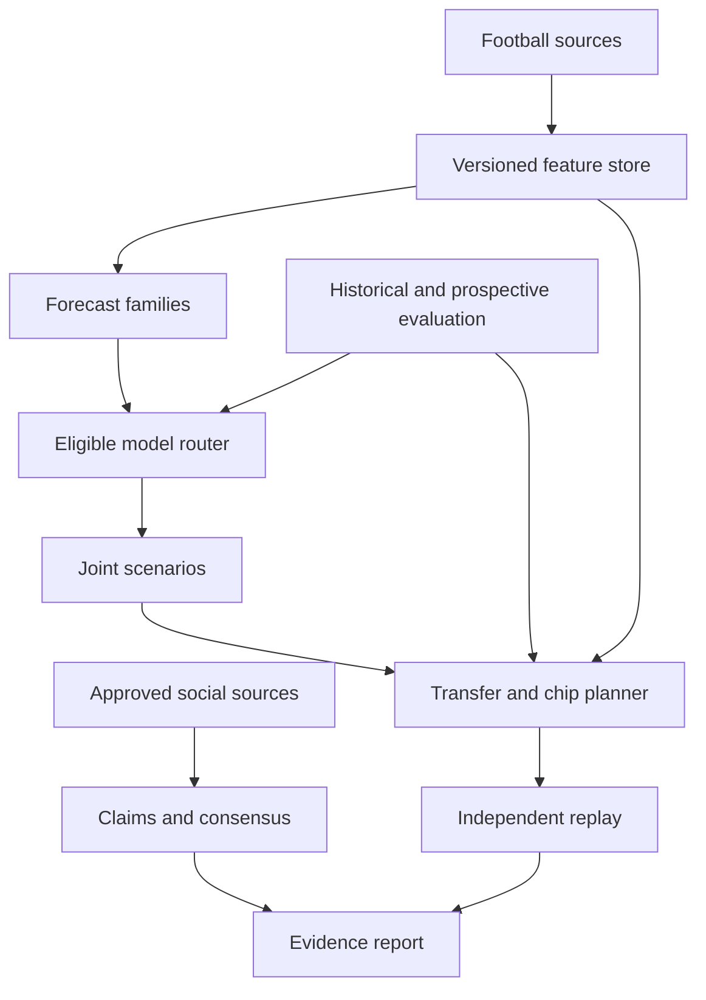

# Forecasting, data and planning specification

Date: 10 October 2026. Companion to `FPL_PRD_V2.md`. Existing contracts are extended through versioned migrations and generated frontend types. Preserve the current local stack.

## Architecture

Keep Next.js, TypeScript, FastAPI, SQLite, Parquet, uv, CatBoost, PyMC, PyTorch Forecasting and HiGHS. Add scikit learn for calibration and evaluation where appropriate. Use the existing worker and local artifact registry before introducing new infrastructure.

Social facts may enter a future forecast adapter only after permitted use and validation. That optional connection is deliberately absent from the initial production path.

## 1. Data acquisition

| Source | Use | Implementation |
| --- | --- | --- |
| Official FPL bootstrap | Player identity, position, prices, availability, available aggregate fields and deadlines | Reuse provider; retain raw versions and normalised observations |
| Official fixtures | Schedule, venue, completion and event allocation | Reuse provider; retain every changed version |
| Official element summary | Fixture histories and prior season summaries | Add bounded collection for the candidate universe, prioritising owned and likely transfer players |
| Public manager endpoints | Published squad and history | Preserve existing import and confirmation flow |
| Vaastav archive | Historical labels and audited historical experiments | Pin source commit and checksums; do not rely on weekly updates |
| Official club and league statements | Public availability and football role information | Collect only through supported access, retaining source links and time evidence |
| Optional licensed football source | Richer match events, xG, xA and lineups | Provider interface; no dependency on access that has not been obtained |
| Approved social providers | Claims and sampled opinion | Separate capability and retention controls from immutable football snapshots |

Start a prospective collector now. Default capture schedule: periodic fixture and bootstrap refreshes, plus snapshots around each deadline and after official event finalisation. The exact cadence is configurable and respects provider limits. A daemon only gathers while it is actually running; do not claim missed deadlines were captured.

The 2026/27 official update says event scores now finalise at 09:00 UK time on the day after the last match. Preserve preliminary and final label versions instead of assuming final points are available three hours after kickoff. Use the real event lock state or verified published finalisation where available. Sources are in `SOURCES.md`.

### Observation envelope

Record provider, resource, provider IDs, canonical IDs, season, event, fixture, schema version, payload checksum, captured time, asserted source publication time, earliest observed time, evidence reference, and revision status. Separate the time a match happened from the time its statistics became usable.

Use canonical person and club mappings with provider and season namespaces. Resolve aliases through explicit mappings. Name similarity proposes a mapping; it does not approve one. Player club, FPL position and eligibility are temporal attributes, especially after transfers and seasonal reclassification.

### Evidence modes

| Mode | Meaning | Permitted claim |
| --- | --- | --- |
| Retrospective assumed | Final archive with conservative lag assumptions | A qualified historical experiment |
| Retrospective reconstructed | Retained input versions with origin evidence | A reconstruction with explicit coverage and remaining uncertainty |
| Prospective shadow | Inputs and predictions actually frozen before outcomes | A contemporaneously recorded challenger forecast |
| Deployed | Eligible artifact routed into real recommendations | The named model actually powers the app |

Keep separate fields for `information_cutoff`, `executed_at`, `artifact_available_at` and `prediction_origin`. Historical replay executed today must never backdate its execution or artifact availability. Its validity depends on which information the simulated fitting process and forecast origin are allowed to use. Live serving additionally requires the artifact to have existed before the live decision origin.

A final historical label can be known today and eligible for fitting a future live forecast. Lack of its original publication version limits historical evaluation claims rather than proving it is unusable forever. Keep the default champion gate strict while allowing honest experimental and shadow modes.

Do not trust a self supplied `timing_verified=true` field as sufficient provenance. Bind it to retained evidence and a documented audit rule. Git commit dates alone are not proof of original publication. Record coverage and conflicts rather than silently manufacturing timing.

## 2. Panels and features

Maintain fixture level labels for scoring and event level rows for planning. Blanks, doubles, absent players, unlisted outcomes and true zero minutes are different states. Produce every eligible scheduled exposure needed by the serving universe. Missing observations never become an assumed nonappearance.

### Proposed features

| Group | Examples | Timing rule |
| --- | --- | --- |
| Identity and rules | Position, club, age of role observation, season scoring regime | Known at origin; season scoped |
| Recent performance | Weighted minutes, starts, points, goals, assists, xG and xA where available | Only completed observations available at origin |
| Longer priors | Shrunk per 90 attack rates, goalkeeper save rates, defensive action rates | Partial pooling; missing coverage visible |
| Fixture | Opponent attack and defence, venue, days to kickoff, event slot | Frozen schedule version |
| Congestion | Rest days, recent workload, known domestic and European schedule | Future schedule allowed; future outcomes prohibited |
| Role | Set pieces, penalties, recent position, substitution patterns | Versioned evidence with expiry |
| Availability | Next event probability, confirmed absence duration, recovery scenarios | Event specific; distinguish provider scope |
| Club strength | Time varying team ratings, expected goals conceded | Estimated using prior usable matches |
| Market context | Price and ownership when justified | Historical snapshots only; keep out of causal performance claims |

Use categorical position, club, opponent and scoring regime rather than arbitrary continuous IDs. Compute priors and normalisers on fitting data only. Retain feature definitions, missingness indicators and per row source references. Audit whether prices and ownership improve forecasts or merely identify historically successful players.

Historical points have different scoring regimes. Train with an explicit rule era and compare recent era performance. Where full match statistics exist, a separate target may rescore them under current rules. Do not infer absent defensive action or BPS inputs as zero to invent a complete current rules label.

For horizon forecasts, create rows for each future fixture from the same current origin. Unknown future form, injuries and lineups are latent quantities. Do not reuse realised future rows as decoder inputs.

## 3. Model A: CatBoost football forecast

First deliver a strong tabular model. Replace the ten input training matrix with the audited football features above. Keep simple baselines as competitors.

Train an unconditional full points mean head. Separately estimate appearance, starts and minute exposure. For minutes, use a mixture with no appearance, short appearance, regular start and long start states, or a calibrated distribution that reflects those states. Validate the 60 minute threshold explicitly. A player with 55 expected minutes is not equivalent to certainty of a 55 minute appearance.

Add quantile heads or a validated distribution model. Keep expected mean separate from median. Calibrate auxiliary probabilities on a calibration period that was not used to fit the underlying model. Preserve coherent constraints such as probability of 60 minutes not exceeding probability of appearance.

For longer horizons use horizon indicators, frozen fixture features, club and role priors, and explicit future availability scenarios. Measure error separately at each lead time. A repeated current forecast is a baseline comparator, not a validated longer horizon model.

Use real football data for training. Synthetic installation tests only prove the implementation can fit and reload. Feature attribution can explain which inputs affected a forecast; it is not a causal explanation of player performance.

## 4. Model B: Bayesian events and joint outcomes

Retain hierarchical team attack and defence and shared match scores. Add temporal team evolution, season transition and promoted club priors. Unseen clubs need explicit uncertain priors, not an automatic rejection that disables all fixtures involving them.

Replace heuristic minutes with calibrated player and role distributions. Joint player scenarios should obey football exposure constraints sufficiently to produce credible substitutions and correlations. Account for goalkeeper rotation or replacement rather than assuming every chosen goalkeeper always plays 90 minutes.

For scoring, cover goals, FPL assists, clean sheets on the relevant playing interval, concessions, saves, penalties, discipline, own goals, defensive contribution and bonus. Several components can initially be calibrated empirical residual distributions. Mark approximation and test against full point labels; do not present a partial sum as a full scoring model.

Conserve shared match goals, avoid impossible self assists, and keep represented and unrepresented player allocations explicit. Do not equate a posterior parameter interval with the outcome distribution of FPL points.

Save joint scenario arrays with player IDs, fixtures, origin, artifact references and seed. Use common draw IDs across players and plans. Check convergence, posterior predictive fit and held out point calibration. Add priors for injury persistence and rotation across events rather than assuming independent appearances every week.

## 5. Model C: TFT across future events

Extend the compact one event model into a genuine decoder for the supported horizon. Use a representation that preserves multiple fixtures in an event, blank events, missing target observations and known schedule context.

Recommended first implementation: one player series over event indices, with future known fixture slots and masks, event total points as the primary target, and a documented fixture decomposition for scoring. Alternatively retain fixture slots with a tested event aggregation rule. Do not add marginal quantiles of two fixtures as if the result were an event quantile.

Supply categorical identity and role context, club and opponent information, minutes history, prior performance, horizon position, known schedule and missingness. Future observations are masked. Train preprocessing only on the fitting partition. Handle new player and season groups explicitly without pretending they are well represented.

Persist best validation checkpoints, hyperparameters, data and code hashes, preprocessing and decoder schema. Evaluate the mean and quantile heads on an untouched test period and in shadow forecasts. Start with bounded CPU experiments; increase model capacity or compute only when the data and measured results justify it.

## 6. Ensemble and serving

Introduce a `ForecastProvider` interface with supported horizons, required features, lifecycle state and an immutable artifact reference. Route prediction jobs through a resolved provider instead of directly calling `baseline_run`.

Eligibility binds the artifact checksum, training information boundary, evaluation report, feature version, mapping version, supported scoring rules and horizon. Requested selection is distinct from resolved selection. Persist the resolved provider in the job input fingerprint. If it is unavailable, return a clear error or an explicit recorded baseline fallback, never a silent advanced model badge.

The CatBoost serving path should enforce the same artifact timing and mapping rules as Bayesian and TFT. Existing adapters differ in their checks; standardise them through the router.

Fit ensemble weights only from chronological out of fold development forecasts. Use shrinkage and compare with the best single model. Assess calibration and strategy impact. Average means only when definitions and targets agree. For distributions, use a calibrated joint construction or compatible scenario mixture. Do not average or add quantiles and call that a joint outcome model.

### Lifecycle

`implemented → trained → retrospectively_evaluated → shadow → eligible → active`

Disabling is possible from any operational state. Promotion is an explicit recorded decision with evidence, not the presence of an `evaluation.json` file. Keep champion and challenger versions, rollback and shadow comparison. A challenger may be trained on real data and remain ineligible for the default recommendations.

## 7. Forecast evaluation

Use expanding or rolling chronological folds with at least one broad held out period. Reserve the final evaluation before tuning. Use at least two completed seasons where available, plus the current scoring era, while reporting coverage. Calendar folds span scoring eras carefully; pooled results cannot hide a weak current era.

Use a separate calibration set or nested chronological calibration. Include validation outcomes used by early stopping within the fitted model's information boundary. Do not use the final test repeatedly to select models.

Compare against zero or simple population prediction where appropriate, rolling points, a shrunk minutes and event model, the existing live baseline, and any external projection whose access and historical origin evidence are suitable. A mean points comparator alone is insufficient for evaluating a football aware forecast.

| Target | Metrics |
| --- | --- |
| Full points mean | MAE, RMSE, bias, event ranking, position and price subgroup error |
| Minutes | MAE, no appearance and short appearance classification, 60 minute calibration |
| Probabilities | Brier score, log loss, reliability curves and uncertainty by subgroup |
| Distributions | Pinball loss, interval coverage and sharpness, proper distribution scores when samples exist |
| Decision relevance | Captain choices, replacement candidate ordering and realised incremental squad points |

Include errors for likely starters and transfer candidates separately. Thousands of low point unused players should not make a forecast look useful for captain selection merely by dominating the metric average.

Use event or contiguous event block resampling for paired differences. Cross event dependence and multiple comparisons limit strong conclusions. Predeclare comparisons and report uncertainty. A narrow positive point estimate is not a guarantee of superiority.

## 8. Strategy replay

Add an evaluator that evolves a legal manager state at each origin, calls a policy using only information then available, applies its immediate actions, scores the actual event with correct substitutions and chips, advances money and transfer inventory, and repeats.

Run several starting squads and conditions. Comparators: frozen Keep, refreshed greedy transfer policy, existing planner, new planner on the same forecasts, and new planner on each forecast family. This separates improvements caused by forecasts from improvements caused by search.

Use an oracle only on small deterministic test universes. It proves search correctness for those cases and is not a deployable hindsight strategy comparator.

Historical state replay requires prices, eligibility, scheduling and scoring versions. If only final snapshots exist, state the assumption and classify the evaluation accordingly. Do not claim a fully realistic policy backtest from the current lagged archive alone.

Primary outcomes: realised points after hits, paired incremental points, worst event blocks, chip uplift, transfer count, decision stability, legality and runtime. Rank claims require a suitable independently modelled field. Forecast net points and realised net points are separate report columns.

## 9. Planning formulation

For each player and event, include binary ownership, starting lineup, captain, vice captain and buy and sell variables. Include chip activation, bank, free transfer inventory, acquisition price and persistent Free Hit state. Model the exact season transitions through independently tested functions or a validated linearisation.

Ownership evolves from prior ownership plus purchases minus sales. Starting lineup is a legal subset of ownership. Captaincy belongs to the starting lineup. Each event satisfies position counts, club limits, liquidity, permitted transfer counts, chip windows and one chip per event.

Prices distinguish market purchase cost and selling proceeds. Sale proceeds depend on the player's acquisition state. Start with frozen price forecasts and disclose them; add explicit price paths later. Do not sell at market value when the owned player has a lower selling value.

Free Hit uses temporary ownership and restores the correct persistent squad and bank. Wildcard updates permanent ownership. Both preserve transfer inventory according to the verified season rules. Chip opportunity cost extends beyond the current event and beyond the detailed forecast horizon.

The deterministic objective must score the starting lineup and captain, plus bench players only where scoring rules or expected substitutions justify them. This addresses the reproduced seven point miss. Bench value is not the sum of all bench point means.

For scenario evaluation define incremental net points `D_s(P)` of plan P relative to the same comparator on shared scenario s. A proposed risk objective is:

`mean(D_s(P)) − λ × CVaRα(max(0, −D_s(P))) + continuation_value(P)`

This is an explicit user preference for downside relative to the comparator. Default λ is zero. Calibrate or sensitivity test continuation value; do not add arbitrary bank points. Scenario results describe the model's uncertainty, not a proven probability of real world success.

First actions must be identical across scenarios. Later contingent actions depend only on information revealed by that event. A scenario optimiser with different first transfers per realised future outcome is a clairvoyant oracle, not a useful policy.

## 10. Search and horizon quality

Implement a deterministic multi event MILP as the next search benchmark. Add diverse near best solutions using cuts or constrained resolves. Validate each through the independent rules engine. Compare complete squad and lineup objectives with exhaustive enumeration in small universes.

If bounded beam search remains useful, score partial states with a forward value estimate, preserve different bank and free transfer states, include explicit funding bundles, make width configurable and reserve time across the horizon. Return search coverage and incumbent history. A zero gap for a candidate proxy never becomes a global plan gap.

Then evaluate candidate policies with joint scenarios. A practical local design can use MILP for candidate construction followed by Monte Carlo reranking with adaptive sample counts. Keep the limitations of this decomposition visible. Report simulation uncertainty and use common random draws.

Default detailed horizon: eight events. Compare four, six and eight event decisions. Expand to twelve only after contracts and lead time forecasts support it. Fit or benchmark terminal free transfer and bank values using continuation rollouts on development data. A reserve budget for a future premium player is an interpretable constraint, not an unfitted universal reward.

Enumerate feasible chip dates within the current window and evaluate restructuring paths. When detailed forecasts do not reach a later chip date, use explicitly approximate macro scenarios. Consider the chip expiration cost at GW19 and season end. Avoid endlessly recommending “save” just because the last eligible event is outside the visible horizon.

## 11. Deliverable contracts

Extend `ProjectionRun` with artifact and eligibility IDs, feature and mapping versions, actual prediction origin, requested and resolved provider, supported horizon, data evidence mode, scoring version, evaluation reference and optional joint scenario reference.

Extend recommendation output with named comparator, horizon expected delta, current event delta, conditional action branches, chip calendar, affordability and probability thresholds, search coverage, input sensitivity, simulation error and actual model provenance.

Use nullable unavailable fields for uncomputed uncertainty. Keep financial readiness gates and state version checks. A saved plan references exact model and source artifacts so later reruns do not silently use updated predictions.

## 12. Verification priorities

Add regression cases for the funding pair counterexample, a beneficial short term sacrifice, roll versus a hit, horizon reversal, terminal inventory value, legal doubles and blanks, current injury versus later recovery scenarios, captain absence and vice fallback, bench order under correlated nonappearances, future chip dates, Free Hit restoration, and uncertain price affordability.

Add data tests for all future feature columns, known decoder covariates, revised labels, transfer and position mappings, missing outcome coverage, rule regime changes and historical execution versus simulated origin timing. Add a serving test proving different eligible artifacts produce different projection jobs and remain reproducible after a worker retry.
